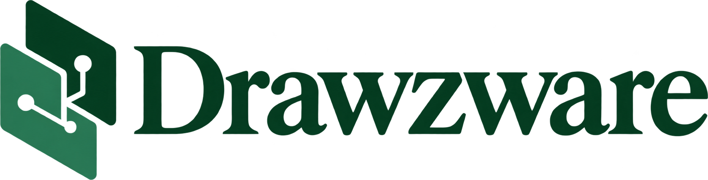
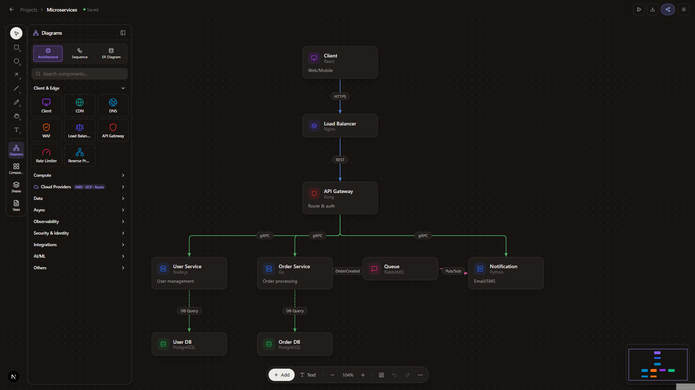
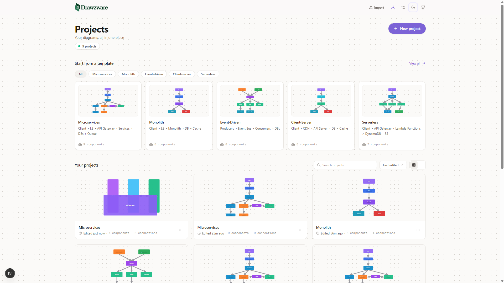
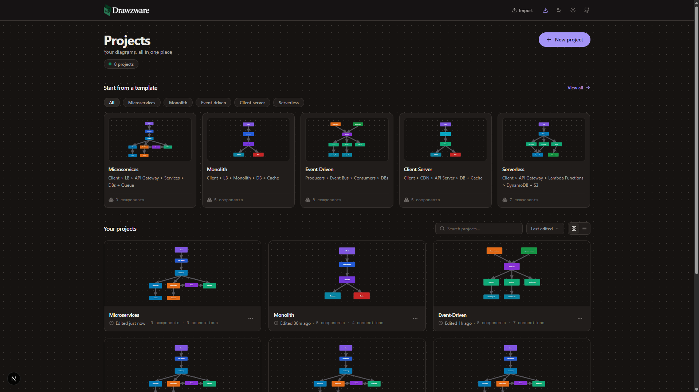
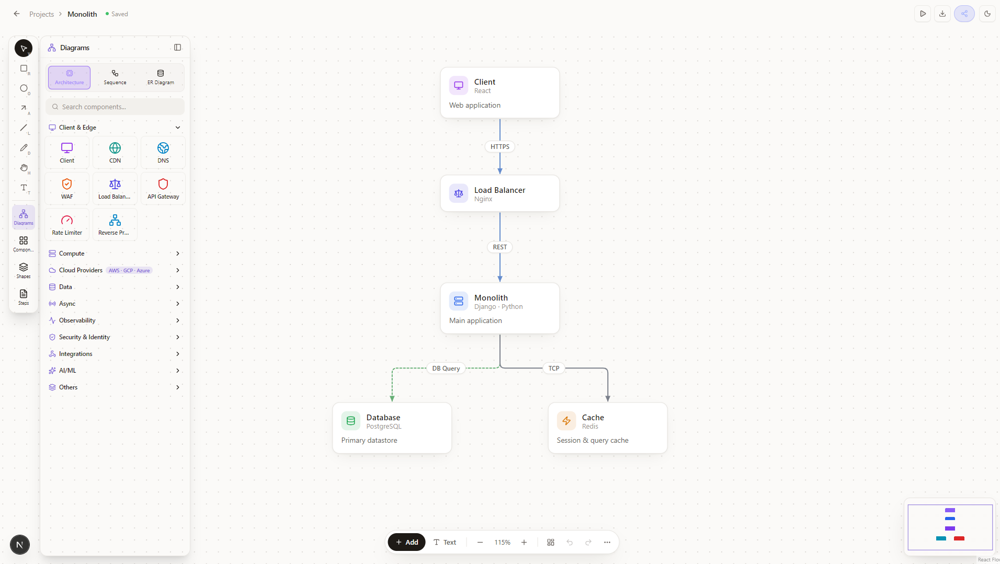
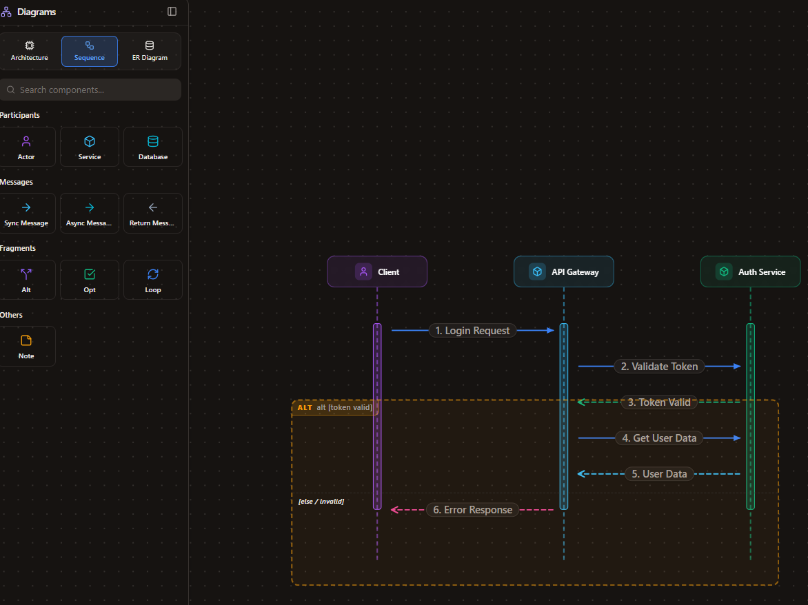
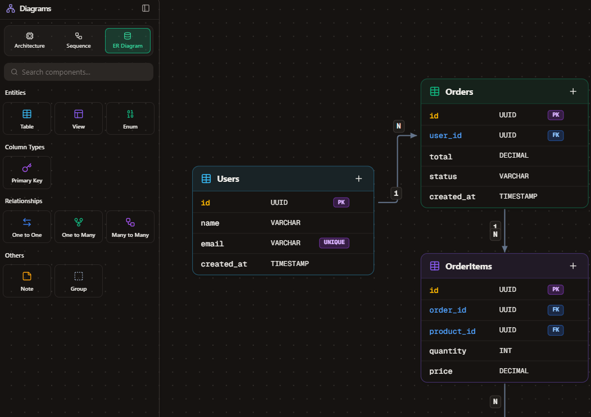
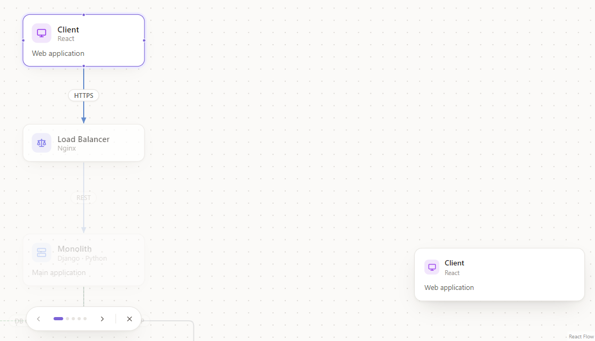
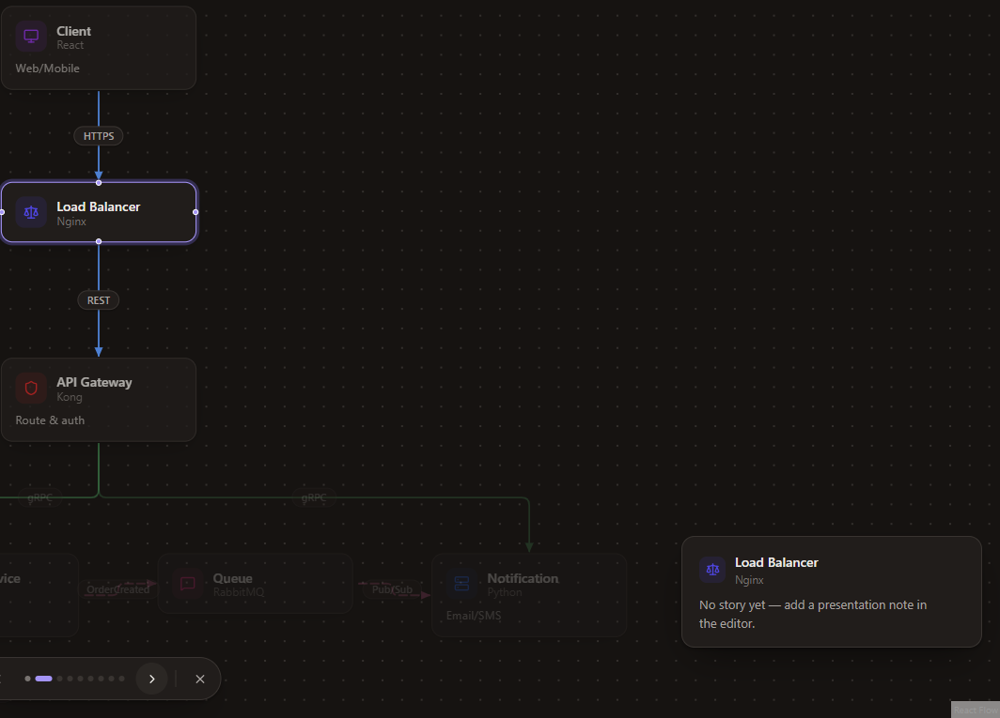

<div align="center">

<picture>
  <source media="(prefers-color-scheme: dark)" srcset="docs/screenshots/drawzware-logo-white.png">
  
</picture>


### Modern System Design & Architecture Diagramming

**Think through, design, and present your distributed systems and architectures before you build them.**

[](LICENSE)
[](https://nextjs.org)
[](https://react.dev)
[](https://reactflow.dev)
[](https://typescriptlang.org)
[](https://tailwindcss.com)
[](https://web.dev/progressive-web-apps/)

[**Features**](#features) • [**Screenshots**](#screenshots) • [**Quick Start**](#quick-start) • [**Templates**](#templates) • [**Tech Stack**](#tech-stack) • [**Contributing**](CONTRIBUTING.md)

---



</div>

## Overview

**Drawzware** is an open-source, client-first visual studio engineered for software architects, systems engineers, and engineering teams. It bridges the gap between rough whiteboard drawings and formal, slow-to-write documentation.

Instead of generic drawing tools with thousands of unrelated clipart shapes, Drawzware provides an opinionated, purpose-built library of system design components, cloud infrastructure primitives (AWS, GCP, Azure), sequence flows, and entity-relationship models that map directly to real-world distributed architectures.

- **Zero Sign-Up Required**: Open the app and begin designing immediately.
- **100% Client-Side Privacy**: All diagram files and configuration stay on your machine in `localStorage`. No data leaves your browser.
- **Progressive Web App (PWA)**: Installable as a standalone desktop or mobile application with offline support.
- **Multi-Diagram Support**: Seamlessly switch between System Architecture, Sequence Diagrams, and ER Models within a unified workspace.

---

## Features

### 1. Dedicated Diagram Modes & Component Library

- **System Architecture**:
  - 19+ core infrastructure primitives (Services, Databases, Caches, API Gateways, Load Balancers, Queues, CDNs, Edge Workers, Event Buses, and more).
  - Built-in **Cloud Providers** catalog with searchable AWS, GCP, and Azure services.
  - 9 structured connection protocols: `REST`, `gRPC`, `GraphQL`, `WebSocket`, `Pub/Sub`, `MQTT`, `SSE`, `TCP`, and `DB Query`.
- **Sequence Diagrams**:
  - Actors, Lifelines, Synchronous & Asynchronous Messages, Self Calls, and Return Messages.
- **Entity-Relationship (ER) Diagrams**:
  - Entities with configurable field types, Primary Keys (`PK`), Foreign Keys (`FK`), and relational cardinality markers.
- **Shapes & Annotations**:
  - Flexible layout containers, generic geometric shapes, text annotations, sticky notes, and grouping frames.
- **System Design Steps**:
  - Guided step cards following industry-standard system design interview frameworks (Functional Requirements, Non-Functional Requirements, High-Level Architecture, Deep Dives, and Scaling / Bottleneck Mitigations).

### 2. Canvas & Editing Capabilities

- **Fluid Infinite Canvas**: Smooth pan, pinch-to-zoom, mini-map preview, dot-grid snapping, and multi-selection box powered by React Flow v12.
- **Auto-Layout**: One-click hierarchical arrangement powered by Dagre graph layout algorithms.
- **Node & Connection Inspector**: Customize component name, description, tech stack tags, port numbers, throughput estimates, and connection latency.
- **Live Design Checks**: Real-time linting flagging disconnected components, missing technologies, single points of failure (SPOF), and likely bottlenecks.
- **Undo / Redo & Clipboard**: Full history stack, native copy/paste, multi-node duplication, and bulk operations.

### 3. Presentation & Collaboration

- **Presentation Mode**: Walks through your architecture step-by-step, highlighting individual services and displaying contextual story cards for stakeholders.
- **Shareable URLs**: The complete diagram state is compressed using LZ-string into the URL fragment. Recipients can open, preview, and save their own copy without a central database.
- **Multi-Format Export**: Export crisp diagrams to PNG (1×, 2×, 3× scale with transparent background support), SVG vector graphics, Mermaid format, and JSON schema.
- **Import Support**: Drag-and-drop native project `.json` files or import existing `docker-compose.yml` configurations directly into visual service nodes.

### 4. Application & System Settings

- **Dark & Light Mode**: Curated OKLCH color palettes tailored for developer ergonomics and presentations.
- **Command Menu (`⌘K` / `Ctrl+K`)**: Rapid navigation, component insertion, and command execution from anywhere in the app.
- **Customizable Preferences**: Toggle snap-to-grid, minimap visibility, animated connection lines, design check warnings, and manage local storage backups.

---

## Screenshots

### Projects Dashboard
Manage your architectures, search projects, or pick from pre-configured production templates.

| Light Mode | Dark Mode |
|---|---|
|  |  |

---

### System Architecture Canvas
Drag and drop infrastructure components, cloud services, and custom protocols.

| Light Mode | Dark Mode |
|---|---|
|  |  |

---

### Sequence Diagrams & Entity-Relationship (ER) Diagrams
Specialized editors for communication lifecycles and database entity modeling.

| Sequence Diagram | ER Diagram |
|---|---|
|  |  |

---

### Presentation Mode
Step-by-step guided architectural walkthroughs with focused storytelling cards.

| Light Mode | Dark Mode |
|---|---|
|  |  |

---

## Quick Start

### Prerequisites
- [Node.js](https://nodejs.org/) (version 18 or higher recommended)
- `npm`, `pnpm`, or `yarn`

### Installation

```bash
# Clone the repository
git clone https://github.com/rajesh-kayal-dev/Drawzware.git

# Navigate to the project directory
cd Drawzware

# Install dependencies
npm install

# Start the development server with Turbopack
npm run dev
```

Open [http://localhost:3000](http://localhost:3000) in your browser to start designing.

---

## Available Scripts

| Script | Command | Description |
|---|---|---|
| `dev` | `npm run dev` | Runs the Next.js development server with Turbopack |
| `build` | `npm run build` | Compiles an optimized static production export into `./out` |
| `start` | `npm run start` | Runs the production server |
| `lint` | `npm run lint` | Runs ESLint across the codebase |
| `deploy:cloudflare` | `npm run deploy:cloudflare` | Builds the static export and deploys to Cloudflare Workers via Wrangler |

---

## Project Structure

```text
Drawzware/
├── docs/
│   └── screenshots/              # Application screenshots and branding assets
├── public/
│   ├── icons/                    # PWA icons (192x192, 512x512)
│   ├── manifest.json             # Web App Manifest for PWA installation
│   ├── sw.js                     # Offline caching service worker
│   └── offline.html              # Fallback offline page
├── src/
│   ├── app/                      # Next.js App Router pages
│   │   ├── canvas/               # Architecture canvas routes
│   │   ├── import/               # Project import route
│   │   ├── settings/             # Modernized settings page
│   │   ├── layout.tsx            # Root layout & PWA registration
│   │   └── page.tsx              # Projects dashboard
│   ├── components/
│   │   ├── canvas/               # Node palette, toolbars, minimap, canvas controls
│   │   ├── edges/                # Custom React Flow edges (animated, protocols)
│   │   ├── layout/               # Header, navbar, theme toggles
│   │   ├── nodes/                # System, cloud, shape, sequence, and ER nodes
│   │   ├── presentation/         # Presentation mode viewer & cards
│   │   ├── project/              # Project list, cards, import dialogs
│   │   └── ui/                   # Reusable UI primitives (dialogs, dropdowns, tooltips)
│   ├── hooks/                    # Custom React hooks (shortcuts, theme, PWA, title)
│   ├── lib/                      # Cloud registries, shape definitions, templates, export
│   ├── stores/                   # Zustand stores (canvas state, project state)
│   └── types/                    # TypeScript interfaces and domain models
└── package.json
```

---

## Architecture Templates

Drawzware ships with 9 pre-built reference architectures ready for immediate customization:

| Template | Architecture Pattern & Flow |
|---|---|
| **Microservices** | Client → Load Balancer → API Gateway → Distributed Services → Databases + Message Queue |
| **Monolith** | Client → CDN / LB → Monolithic Application Server → Primary DB + Redis Cache |
| **Event-Driven** | Event Producers → Event Bus / Broker → Consumer Workers → Datastores |
| **Client-Server** | Mobile / Web Client → CDN → Backend API Service → Relational Database + Cache |
| **Serverless** | Single Page App → API Gateway → Serverless Functions → NoSQL DB + Blob Storage |
| **Data Pipeline** | Ingestion Sources → Kafka Broker → Stream Processors → Data Warehouse / Lakehouse |
| **Real-time Analytics** | Ingest API → Message Queue → Stream Analytics Engine → Search Index + Realtime UI |
| **Serverless Fullstack** | Global CDN Edge → API Gateway → Serverless Compute → Serverless Database + SQS Queue |
| **Kubernetes Platform** | Ingress Controller → K8s Cluster Services → StatefulSets + Prometheus Observability |

---

## Keyboard Shortcuts

| Action | Windows / Linux | macOS |
|---|---|---|
| **Command Palette** | `Ctrl + K` | `⌘ + K` |
| **Keyboard Shortcuts Help** | `?` | `?` |
| **Toggle Component Library** | `/` | `/` |
| **Fit View to Canvas** | `F` | `F` |
| **Presentation Mode** | `P` | `P` |
| **Duplicate Selection** | `Ctrl + D` | `⌘ + D` |
| **Delete Selection** | `Delete` / `Backspace` | `⌫` |
| **Reverse Edge Connection** | `Shift + R` | `⇧ + R` |
| **Undo / Redo** | `Ctrl + Z` / `Ctrl + Shift + Z` | `⌘ + Z` / `⇧ + ⌘ + Z` |
| **Copy / Paste** | `Ctrl + C` / `Ctrl + V` | `⌘ + C` / `⌘ + V` |
| **Select All Elements** | `Ctrl + A` | `⌘ + A` |
| **Close Open Panel / Modal** | `Esc` | `Esc` |

---

## Tech Stack

| Layer | Technology | Purpose |
|---|---|---|
| **Framework** | [Next.js 16 (App Router)](https://nextjs.org/) + [React 19](https://react.dev/) | React server/client framework with static exports |
| **Language** | [TypeScript 5](https://www.typescriptlang.org/) | Full-codebase end-to-end type safety |
| **Canvas Engine** | [@xyflow/react (React Flow v12)](https://reactflow.dev/) | High-performance visual node graph engine |
| **State Management** | [Zustand v5](https://zustand-demo.pmnd.rs/) | Fast, un-opinionated reactive canvas store |
| **Styling & Design** | [Tailwind CSS v4](https://tailwindcss.com/) + OKLCH Tokens | Low-latency utility CSS with accessible color scales |
| **UI Components** | [shadcn/ui](https://ui.shadcn.com/) + [Radix UI](https://www.radix-ui.com/) | Accessible, unstyled dialogs, menus, and sheets |
| **Icons & Typography** | [Lucide React](https://lucide.dev/) + Geist Font | Clean, consistent icons and developer typography |
| **Graph Layout** | [@dagrejs/dagre](https://github.com/dagrejs/dagre) | Directed graph automated layout positioning |
| **Export Engines** | [html-to-image](https://github.com/bubkoo/html-to-image) | High-DPI PNG and SVG canvas rendering |
| **Compression** | [lz-string](https://github.com/pieroxy/lz-string) | URL-safe payload compression for link sharing |
| **Schema Validation** | [Zod](https://zod.dev/) | Runtime data validation and project integrity |
| **PWA & Offline** | Web Manifest + Service Worker | Offline runtime and standalone desktop/mobile installation |

---

## Deployment

Because Drawzware is 100% client-side, it compiles to static assets (`output: "export"` in Next.js) and can be hosted on any static hosting platform.

- **Vercel**: Deploy directly by connecting your repository. Production and preview deployments work out of the box (`vercel.json` included).
- **Cloudflare Workers / Pages**: Run `npm run deploy:cloudflare` to build and deploy static assets directly with Wrangler (`wrangler.jsonc` included).
- **GitHub Pages / Netlify / AWS S3**: Deploy the generated `./out` directory to any static file server.

---

## Community & Contributing

We welcome community contributions, suggestions, and feedback! Please review our community guidelines:

- [**Contributing Guide**](CONTRIBUTING.md) — How to set up your environment, follow coding conventions, and submit pull requests.
- [**Code of Conduct**](CODE_OF_CONDUCT.md) — Standards and expectations for an inclusive and respectful community.
- [**Security Policy**](SECURITY.md) — How to responsibly and privately disclose security vulnerabilities.

---

## License

Distributed under the **MIT License**. See [LICENSE](LICENSE) for more information.
