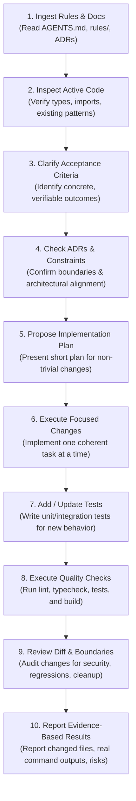
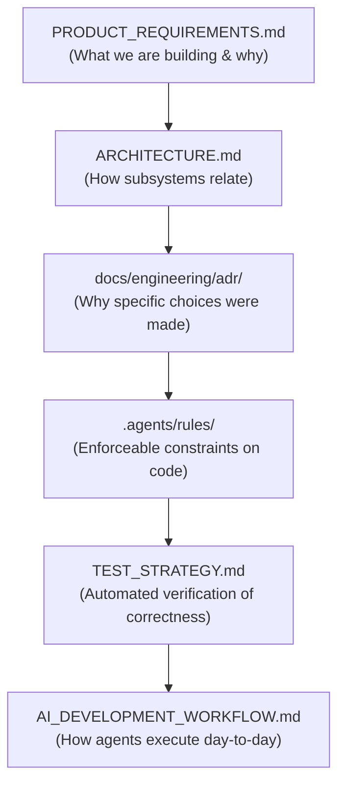

# Drawzware Desktop — AI Development & Pair Programming Workflow

**Status:** Standard Operating Procedure (SOP)  
**Author:** Principal Software Engineer & AI Workflow Architect  
**Scope:** Development Standards, Step-by-Step Task Lifecycle, and Quality Discipline for AI Coding Agents  

---

## 1. Overview of the AI Development System

This document outlines the repeatable, rigorous development workflow required of any AI coding assistant (including Antigravity, Claude, or autonomous subagents) working on the Drawzware codebase.

The goal is to eliminate common AI failure modes: speculative rewrites, hallucinated test results, unvetted dependencies, broken process boundaries, and silent data loss.

---

## 2. The 10-Step Development Lifecycle

Every coding task assigned to an AI agent must strictly follow this sequential cycle:



### Step 1: Read Project Instructions & Rules
- Review [AGENTS.md](file:///d:/AI%20Projects/drawzware-system-design-canvas/AGENTS.md) and relevant `.agents/rules/*.md` files.
- Never begin editing files without checking the specific rules governing that subsystem (e.g. `desktop-security.md` when touching `electron/`, or `typescript-react.md` when touching `src/`).

### Step 2: Inspect the Affected Source Code
- Read the actual target files and their type definitions using `view_file`.
- Never guess component props, method signatures, or hook return types.
- Check existing test files to understand established testing conventions.

### Step 3: Understand the Requirement & Acceptance Criteria
- Distinguish between explicit user requests and open design choices.
- Identify the exact conditions under which the task will be considered complete.

### Step 4: Identify Relevant Architecture Decisions (ADRs)
- Cross-reference the proposed change with `docs/engineering/adr/`.
- Ensure changes align with accepted decisions (e.g. ADR-002 discrete document storage, ADR-004 strict IPC isolation).
- Never introduce an architectural paradigm that contradicts an existing ADR without flagging it explicitly.

### Step 5: Present a Short Implementation Plan
- For non-trivial tasks (affecting multiple files or introducing new logic), summarize:
  1. Files to create or modify.
  2. Concrete changes planned.
  3. Tests to be added or updated.
  4. Validation commands to execute.

### Step 6: Implement One Coherent Task at a Time
- Keep modifications minimal and focused on the stated requirement.
- Do not perform drive-by refactoring of unrelated code.
- Maintain existing comments, docstrings, and formatting conventions.

### Step 7: Add or Update Automated Tests
- For domain logic or state updates, write Vitest unit tests.
- For persistence or IPC changes, write integration tests.
- For UI workflows, write Playwright E2E tests.

### Step 8: Execute Verification Checks
- Run the required quality checks sequentially:
  ```bash
  npm run lint         # Must pass with zero errors
  npx tsc --noEmit     # Must pass with zero type errors
  npm test             # Must pass all tests
  npm run build        # Static export must compile cleanly
  ```
- **Rule of Truth:** Report the actual terminal output. If a check fails, diagnose and fix it immediately. Never suppress or hide errors.

### Step 9: Review the Code Diff
- Inspect the diff before concluding:
  - Did any privileged Node.js APIs leak into `src/`?
  - Are all imported schemas parsed with `.safeParse()`?
  - Are any hardcoded secrets, test credentials, or personal paths present?
  - Did any forbidden default Tailwind colors (`gray-*`, `slate-*`) slip in?

### Step 10: Report Results & Follow-Up Work
- Provide a concise summary:
  1. Files changed (with clickable markdown links).
  2. Real validation outputs.
  3. Any residual risks or follow-up items.

---

## 3. How to Split Large Tasks

Large desktop application tasks can easily become overwhelming or lead to context degradation. Agents must decompose tasks using the following rules:

1. **Rule of Single Responsibility:** A single task should touch either the main process (IPC/storage), the preload bridge, or the renderer UI—rarely all three in one unverified step.
2. **Horizontal Layering:**
   - *Phase A:* Define TypeScript IPC contracts and schema interfaces.
   - *Phase B:* Implement backend/main-process logic and unit tests.
   - *Phase C:* Implement preload exposure.
   - *Phase D:* Connect renderer Zustand store / React components.
   - *Phase E:* End-to-end integration test.
3. **Never Accumulate Unverified Code:** Every layer must be verified before proceeding to the next.

---

## 4. When to Stop and Ask for Clarification

Agents must immediately pause and seek user guidance instead of guessing when:

1. **Ambiguous Data Ownership:** The requirement does not specify whether data should overwrite existing files, create duplicates, or prompt the user.
2. **Security vs. Convenience Conflicts:** A requested feature would require weakening the Electron sandbox (`nodeIntegration: true` or disabling CSP).
3. **Platform Incompatibilities:** A proposed native feature behaves fundamentally differently across Windows, macOS, and Linux without an agreed compromise.
4. **Unresolved Decisions:** The task depends on an open item in `docs/engineering/DECISIONS_REQUIRED.md`.

---

## 5. Artifact Relationship & Governance Matrix



Every artifact has a clear governance role:
- **Requirements (PRD):** Define the *what*.
- **Architecture & ADRs:** Define the *how* and the *why*.
- **Agent Rules:** Define what is *forbidden* and what is *mandatory*.
- **Tests:** Mathematically prove that requirements are met.
- **Workflow:** Defines the human-AI pair programming contract.
