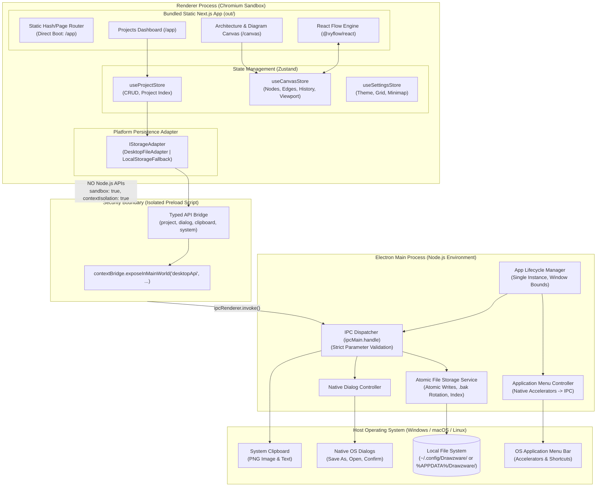
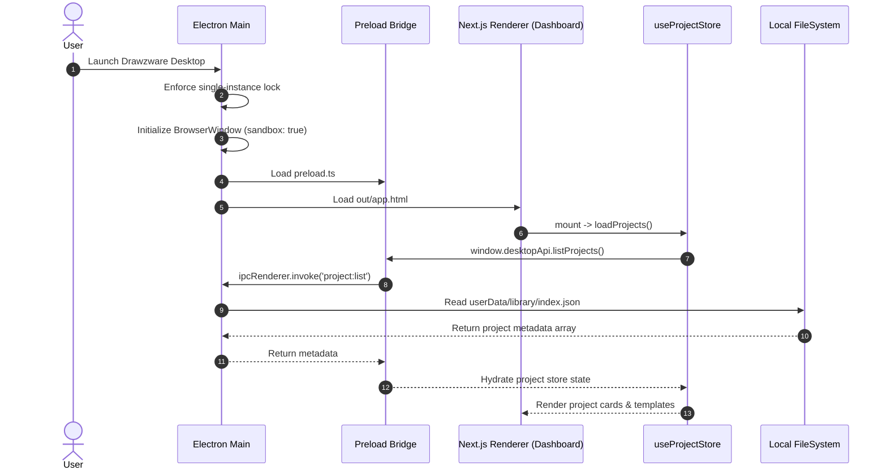
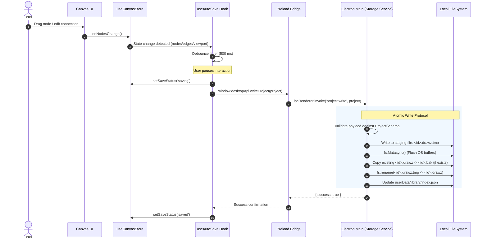
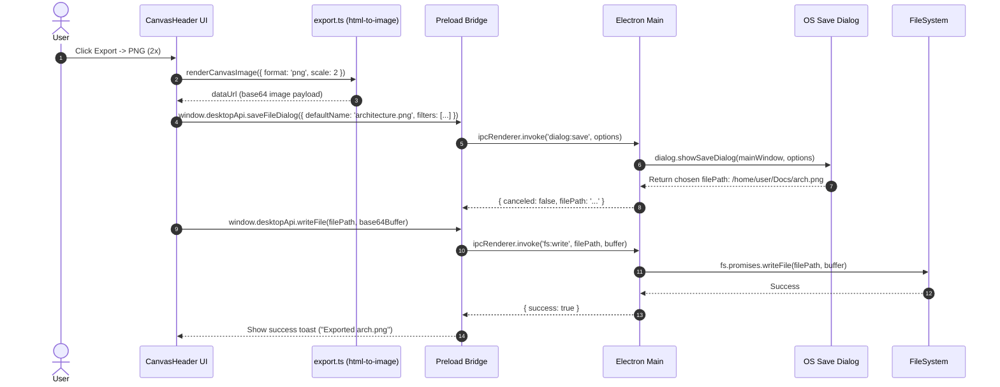
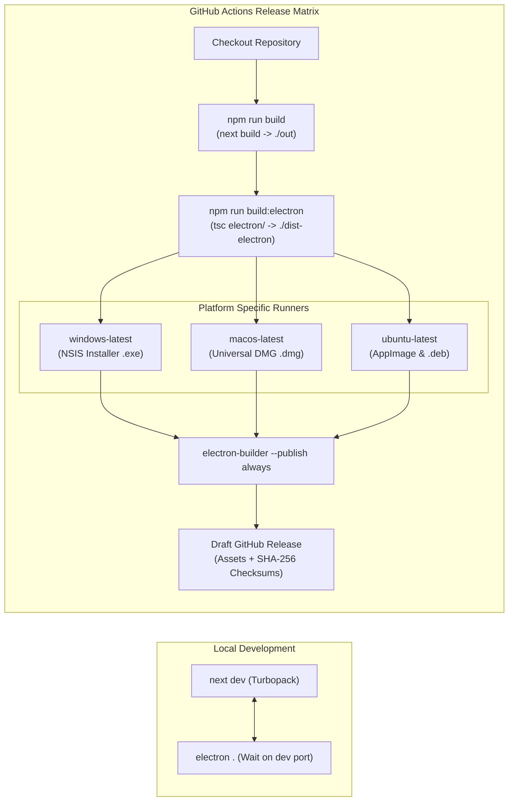

# Drawzware Desktop — Target Architecture Specification

**Status:** Proposed Architecture  
**Author:** Principal Software Engineer & Product Architect  
**Scope:** Core Desktop Architecture, Process Model, Storage, Security & Build Pipeline  
**Target Release:** Desktop v1.0.0  

---

## 1. Architectural Overview & Design Principles

Drawzware Desktop transforms the verified static-export Next.js web application into an offline-first, native desktop application using **Electron**.

### Core Architecture Principles:
1. **Zero-Backend Client-First Runtime:** The application contains zero remote server or database dependencies. Everything runs locally inside the user's execution environment.
2. **Reuse Existing Static Frontend Without Regressions:** The existing React 19, `@xyflow/react`, Zustand, and Tailwind CSS v4 codebase is preserved intact. Next.js continues compiling to static HTML/CSS/JS via `output: "export"`.
3. **Strict Privilege Separation:** The Chromium renderer process is completely sandboxed. Privileged operating system access (filesystem, native dialogs, application menus) resides exclusively in the Electron main process and is exposed via a typed, minimal `contextBridge` preload interface.
4. **Atomic, Resilient Document Persistence:** Project data is decoupled from the 5 MB browser `localStorage` bottleneck and stored as atomic, versioned files (`.drawz` / `.json`) with automatic backup rotation and crash recovery.
5. **No Architectural Overengineering:** No SQLite database, no local HTTP/Express server, no heavy IPC microservices. Direct, observable file-based documents with simple JSON serialization.

---

## 2. Multi-Process Architecture & Process Isolation



---

## 3. Subsystem Responsibilities

### 3.1 Electron Main Process (`electron/main.ts`)
- **Lifecycle Management:** Controls application initialization, window creation, single-instance locking (`app.requestSingleInstanceLock()`), and graceful shutdown.
- **Window Configuration:**
  - Instantiates `BrowserWindow` with `webPreferences`:
    ```typescript
    webPreferences: {
      preload: path.join(__dirname, 'preload.js'),
      contextIsolation: true,
      nodeIntegration: false,
      sandbox: true,
      webSecurity: true,
      allowRunningInsecureContent: false,
    }
    ```
  - Direct route entry: loads `out/app.html` on startup (bypassing `out/index.html`).
- **Storage Service (`electron/services/storage.ts`):** Implements atomic file writing, reading, backup creation, and project deletion in the user data directory.
- **Dialog Service (`electron/services/dialog.ts`):** Invokes `dialog.showOpenDialog` and `dialog.showSaveDialog` with appropriate MIME filters (`.drawz`, `.json`, `.png`, `.svg`, `.mmd`, `.yaml`).
- **Application Menu (`electron/menu.ts`):** Defines native menus with accelerators (`CmdOrCtrl+S`, `CmdOrCtrl+O`, `CmdOrCtrl+Z`, `CmdOrCtrl+K`), forwarding menu events to the renderer window via IPC.

### 3.2 Preload Bridge (`electron/preload.ts`)
Exposes a strictly typed API to the renderer under `window.desktopApi`.
```typescript
export interface DesktopAPI {
  // Project Storage
  listProjects: () => Promise<ProjectMetadata[]>;
  readProject: (id: string) => Promise<Project>;
  writeProject: (project: Project) => Promise<{ success: boolean; error?: string }>;
  deleteProject: (id: string) => Promise<boolean>;
  
  // File Operations & Dialogs
  openFileDialog: (options?: OpenOptions) => Promise<{ canceled: boolean; filePath?: string; content?: string }>;
  saveFileDialog: (options: SaveOptions) => Promise<{ canceled: boolean; filePath?: string }>;
  writeFile: (filePath: string, data: string | Buffer) => Promise<{ success: boolean; error?: string }>;
  
  // System & Window
  getAppVersion: () => Promise<string>;
  openExternal: (url: string) => Promise<void>;
  onMenuAction: (callback: (action: string) => void) => () => void;
}
```

### 3.3 Renderer Process (Next.js Static Frontend)
- **App Dashboard (`src/app/app/page.tsx`):** Displays projects loaded from `IStorageAdapter`, pre-configured templates, and import drop zones.
- **Canvas Editor (`src/app/canvas/page.tsx`):** Coordinates `@xyflow/react`, floating toolbars, editors, and the breadcrumb header.
- **Zustand State Stores:**
  - `useProjectStore`: Manages project collections in memory.
  - `useCanvasStore`: Manages active diagram nodes, edges, viewport, history, and tools.
  - `useSettingsStore`: Manages preferences (theme, snap, minimap, validation).

### 3.4 Storage Abstraction (`src/lib/storage-adapter.ts`)
A clean abstraction decouples UI stores from specific persistence backends:
```typescript
export interface IStorageAdapter {
  isDesktop: boolean;
  loadProjects(): Promise<Project[]>;
  saveProject(project: Project): Promise<boolean>;
  deleteProject(id: string): Promise<boolean>;
  exportProjectFile(id: string, format: 'drawz' | 'json'): Promise<boolean>;
  importProjectFile(): Promise<Project | null>;
}
```
- In desktop mode, `DesktopStorageAdapter` delegates to `window.desktopApi`.
- In web/PWA mode (or during preview development), `LocalStorageAdapter` falls back gracefully to `localStorage`.

---

## 4. Key Data Flows

### 4.1 Application Boot & Project Hydration


### 4.2 Autosave & Atomic Disk Write


### 4.3 Native Export Operation


---

## 5. Storage Topology & Filesystem Layout

The desktop application maintains a structured directory hierarchy inside the standard operating system application data folder:
- **Windows:** `%APPDATA%\Drawzware\`
- **macOS:** `~/Library/Application Support/Drawzware/`
- **Linux:** `~/.config/Drawzware/` (or `$XDG_CONFIG_HOME/Drawzware/`)

```
Drawzware/
├── config.json                     # App preferences (window bounds, theme, recent files)
├── library/                        # Default internal workspace
│   ├── index.json                  # Project index (id, name, updatedAt, nodeCount)
│   ├── projects/                   # Discrete project documents
│   │   ├── 8f14-9b2c.drawz         # Individual project JSON document
│   │   ├── e3b0-7a4f.drawz
│   │   └── ...
│   └── backups/                    # Automatic recovery snapshots
│       ├── 8f14-9b2c.bak           # Previous successful write backup
│       └── crash-journal.json      # Pending save journal if crash occurred
└── logs/                           # Rolling diagnostic log files (no PII)
    ├── main.log
    └── main.old.log
```

---

## 6. Proposed Repository Directory Structure

```
drawzware/
├── .agents/                        # AI Coding Agent Rules & Guidelines
│   └── rules/
│       ├── architecture.md         # Process boundaries & module constraints
│       ├── typescript-react.md     # Code style & React patterns
│       ├── testing.md              # Quality & verification expectations
│       └── desktop-security.md     # Electron security & IPC invariants
├── AGENTS.md                       # Project-wide engineering manifesto
├── CLAUDE.md                       # Existing repository notes (preserved)
├── docs/                           # Documentation
│   └── engineering/                # Engineering planning package
│       ├── PRODUCT_REQUIREMENTS.md
│       ├── ARCHITECTURE.md
│       ├── DATA_AND_MIGRATION.md
│       ├── TEST_STRATEGY.md
│       ├── IMPLEMENTATION_PLAN.md
│       ├── DECISIONS_REQUIRED.md
│       ├── AI_DEVELOPMENT_WORKFLOW.md
│       └── adr/                    # Architecture Decision Records
│           ├── ADR-001-desktop-framework-and-packaging.md
│           ├── ADR-002-workspace-model-and-persistence.md
│           ├── ADR-003-browser-data-migration-and-compatibility.md
│           ├── ADR-004-desktop-security-boundaries-and-ipc.md
│           ├── ADR-005-testing-and-quality-strategy.md
│           └── ADR-006-cross-platform-release-and-signing.md
├── electron/                       # Electron Native Subsystem (NEW)
│   ├── main.ts                     # Main process entry & window management
│   ├── preload.ts                  # Typed contextBridge security bridge
│   ├── menu.ts                     # Native application menus & accelerators
│   ├── services/                   # Main process service modules
│   │   ├── storage.service.ts      # Atomic filesystem persistence
│   │   ├── dialog.service.ts       # Native OS dialogs
│   │   └── config.service.ts       # Window bounds & user preferences
│   ├── types/
│   │   └── ipc.ts                  # Strongly typed IPC channel contracts
│   └── tsconfig.json               # TypeScript config for Electron Node process
├── src/                            # Existing Next.js & React Frontend (PRESERVED)
│   ├── app/                        # App Router pages (/app, /canvas, /settings)
│   ├── components/                 # UI, canvas, node, edge, and layout components
│   ├── hooks/                      # React hooks (useAutoSave, useTheme, etc.)
│   ├── lib/                        # Domain logic, auto-layout, export, validation
│   │   ├── storage-adapter.ts      # NEW: Storage abstraction interface
│   │   ├── desktop-adapter.ts      # NEW: Electron IPC storage adapter
│   │   └── storage.ts              # Existing localStorage adapter (fallback)
│   ├── stores/                     # Zustand stores (useCanvasStore, useProjectStore)
│   └── types/                      # Domain models (Project, SystemNode, SystemEdge)
├── electron-builder.yml            # Multi-platform installer packaging configuration
├── next.config.ts                  # Static export configuration (output: 'export')
├── package.json                    # Scripts and dependencies
└── tsconfig.json                   # Web application TypeScript config
```

---

## 7. Build and Release Pipeline



### Static Asset Loading Feasibility:
- Electron's `BrowserWindow.loadFile(path.join(__dirname, '../out/app.html'))` or a custom standard protocol (`app://`) serves static assets seamlessly.
- Relative assets (`/_next/static/...`) in `./out` resolve directly from disk without HTTP network overhead.
- Query parameter routing (`/canvas.html?id=...`) works reliably in Electron local file loading.
