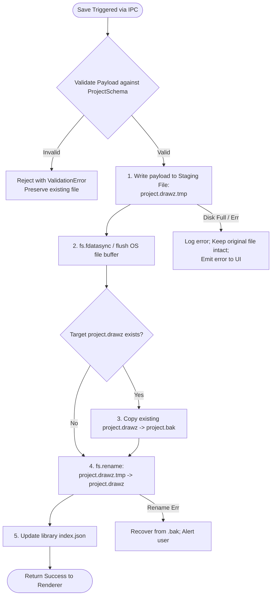

# Drawzware Desktop — Data Architecture and Migration Specification

**Status:** Proposed Specification  
**Author:** Principal Software Engineer & Product Architect  
**Scope:** Data Models, Persistence Lifecycle, Schema Versioning, Atomic Safety, and Migration Strategy  

---

## 1. Existing Data Model Audit

### 1.1 Source-Verified Schema Definitions
The current web application defines all domain entities in [src/types/index.ts](file:///d:/AI%20Projects/drawzware-system-design-canvas/src/types/index.ts).

#### 1. Project Entity (`ProjectSchema`)
```typescript
export const ProjectSchema = z.object({
  id: z.string(),
  name: z.string(),
  description: z.string().optional(),
  createdAt: z.string(),
  updatedAt: z.string(),
  nodes: z.array(z.any()),
  edges: z.array(z.any()),
  viewport: z.object({
    x: z.number(),
    y: z.number(),
    zoom: z.number(),
  }).default({ x: 0, y: 0, zoom: 1 }),
  diagramType: z.enum(['architecture', 'sequence', 'er']).optional(),
  diagramData: z.record(z.string(), z.unknown()).optional(),
});
```

#### 2. Root Storage Envelope (`AppDataSchema`)
```typescript
export const AppDataSchema = z.object({
  version: z.number().default(1),
  projects: z.array(ProjectSchema).default([]),
  lastOpenedProjectId: z.string().nullable().default(null),
});
```

#### 3. Component & Edge Data Models
- **Nodes (`SystemNodeDataSchema`):** Encapsulates `label`, `nodeType` (19 core infrastructure types + cloud/DevOps/AI extensions), `techStack: string[]`, `status`, `environment`, `story` (presentation cards), `links`, custom shapes, ER columns (`ERColumn[]`), sequence lifelines, and freehand pencil coordinate point arrays (`points: {x, y}[]`).
- **Edges (`SystemEdgeDataSchema`):** Encapsulates `edgeType` (`rest`, `grpc`, `graphql`, `websocket`, `pub-sub`, `mqtt`, `event-stream`, `tcp`, `db-query`), `label`, `latency`, `throughput`, `dataFormat`, `relationshipType`, and routing geometry (`routeType: smoothstep | bezier | straight`).

---

## 2. Identified Vulnerabilities in Existing Storage

Our audit of [src/lib/storage.ts](file:///d:/AI%20Projects/drawzware-system-design-canvas/src/lib/storage.ts) revealed three critical data safety risks:
1. **Silent Catastrophic Wipe on Schema Parse Failure:**
   Lines 20–26 of `storage.ts`:
   ```typescript
   if (result.success) return migrate(result.data);
   console.warn('Invalid storage data, resetting');
   return { version: CURRENT_VERSION, projects: [], lastOpenedProjectId: null };
   ```
   If a single project in the array has unexpected data, or if JSON syntax is slightly truncated, the parser logs a warning and returns an empty projects array (`[]`). Once the user makes an edit or creates a new diagram, `useProjectStore` calls `saveAppData(emptyData)`, **permanently wiping all previous projects**.
2. **Monolithic Serialization Overhead:**
   Every single autosave trigger (500 ms debounce) iterates over all projects in memory, formats the entire array as a single JSON string, and overwrites the entire `system-design-canvas` key in `localStorage`.
3. **Hard 5 MB Storage Ceiling:**
   Browsers enforce a strict quota (~5 MB) on `localStorage`. A project with detailed freehand drawings (hundreds of vector points) or multiple detailed ER schemas can exceed this limit rapidly, causing `localStorage.setItem` to throw unhandled `QuotaExceededError` exceptions.

---

## 3. Desktop Target Data Architecture

### 3.1 Discrete Document Model (`.drawz` / `.json`)
Drawzware Desktop replaces the monolithic array storage with a **discrete document architecture**. Each project is an independent JSON document on the local disk.

```
userData/library/
├── index.json                   # Lightweight metadata catalog
└── projects/
    ├── 8f14-9b2c-47a1.drawz     # Complete Project document
    ├── 3e2a-11bc-99f0.drawz
    └── ...
```

#### Document Format (`.drawz` / Project JSON)
```json
{
  "version": 1,
  "id": "8f14-9b2c-47a1",
  "name": "Global Payment Processing Pipeline",
  "description": "High-throughput microservices architecture with Kafka event bus",
  "createdAt": "2026-10-14T10:00:00.000Z",
  "updatedAt": "2026-10-14T16:30:00.000Z",
  "viewport": { "x": -150, "y": 80, "zoom": 0.85 },
  "diagramType": "architecture",
  "diagramData": {
    "architecture": { "nodes": [...], "edges": [...] },
    "sequence": { "nodes": [...], "edges": [...] },
    "er": { "nodes": [...], "edges": [...] }
  },
  "nodes": [...],
  "edges": [...]
}
```

#### Library Metadata Index (`index.json`)
To enable instantaneous dashboard rendering without reading dozens of large diagram files from disk on startup, the main process maintains a lightweight index:
```json
{
  "version": 1,
  "lastOpenedProjectId": "8f14-9b2c-47a1",
  "projects": [
    {
      "id": "8f14-9b2c-47a1",
      "name": "Global Payment Processing Pipeline",
      "description": "High-throughput microservices architecture",
      "createdAt": "2026-10-14T10:00:00.000Z",
      "updatedAt": "2026-10-14T16:30:00.000Z",
      "nodeCount": 24,
      "edgeCount": 38,
      "filePath": "projects/8f14-9b2c-47a1.drawz"
    }
  ]
}
```

---

## 4. Atomic Write & Corruption Prevention Protocol

To guarantee zero data loss during power failures, unexpected OS shutdowns, or application crashes during save operations, the main process executes the **Atomic Staging Protocol**:



### Protocol Rules:
1. **Never Overwrite in Place:** Writes never target the live `.drawz` file directly. A temporary file (`<id>.drawz.tmp`) is always written first.
2. **Buffer Synchronization:** After writing the temporary file, `fs.fdatasync()` is executed to force the operating system to flush kernel cache buffers to physical disk storage.
3. **Rolling Backup:** If an existing version of the file exists, it is copied to `<id>.bak` in the `backups/` directory before renaming.
4. **POSIX & Windows Atomic Replacement:** Calling `fs.promises.rename(tmpPath, targetPath)` replaces the destination file atomically on POSIX systems and modern Windows NTFS/ReFS filesystems. The file is never left in an unreadable half-written state.

---

## 5. Corrupted File Isolation & Recovery Workflow

### Never Silently Reset User Data
Under no circumstances will Drawzware Desktop replace invalid project files with an empty workspace.

### Recovery Procedure:
1. **Quarantine:** If a `.drawz` file fails JSON parsing or schema validation upon loading, the main process renames the corrupted file to `<id>.corrupted.<timestamp>.json` so no data is destroyed.
2. **Backup Fallback:** The loader automatically inspects `userData/library/backups/<id>.bak`.
3. **User Prompt:** If a valid backup is available, the UI displays a non-destructive recovery modal:
   > **"Diagram Recovery Available"**  
   > The project file "Global Payment Pipeline" was damaged or unreadable. A valid backup from 10 minutes ago was found.  
   > `[ Restore from Backup ]` `[ Inspect Corrupted File ]` `[ Cancel ]`
4. **Manual Recovery Option:** If no backup exists, the user is offered the option to export the raw text of the corrupted file to their desktop for manual JSON repair.

---

## 6. Migration from Browser Web Application

### User Workflow for Existing Web Users:
1. **Web Export:** In the Drawzware web application, the user clicks `Settings > Data > Export all projects`, downloading `drawzware-YYYY-MM-DD.json`.
2. **Desktop Ingestion:** On first launch of Drawzware Desktop, the dashboard displays an empty-state banner:
   > **"Moving from Drawzware Web?"**  
   > Drag and drop your exported backup JSON file here to bring all your projects into the desktop app.  
   > `[ Browse Backup File… ]`
3. **Extraction & Ingestion:**
   - The user selects or drops `drawzware-YYYY-MM-DD.json`.
   - The storage service parses the backup payload via `parseJsonImport()`.
   - Each project is validated, assigned an atomic file in `userData/library/projects/<id>.drawz`, and added to `index.json`.
   - A success notification confirms: `"Successfully imported 14 projects from web backup."`

---

## 7. Software Upgrades and Schema Migrations

### 7.1 Schema Versioning Policy
Every project file carries an integer `version` field (currently `version: 1`).

### 7.2 Migration Runner Pipeline
When a project file is read from disk, it passes through the sequential migration pipeline in `src/lib/storage.ts`:
```typescript
export function migrateProject(data: unknown): Project {
  let project = data as Record<string, unknown>;
  const version = typeof project.version === 'number' ? project.version : 1;
  
  if (version < 2) {
    // Future v2 migrations (e.g. normalizing handle ids or converting custom shapes)
    // project = migrateV1ToV2(project);
  }
  
  return ProjectSchema.parse(project);
}
```

### 7.3 Data Persistence Across Desktop App Updates
- The `userData` directory is managed by the operating system and is located **outside** the application installation directory.
- Upgrading or reinstalling Drawzware Desktop (via NSIS installer on Windows, DMG drag on macOS, or AppImage replacement on Linux) leaves `userData/library/` completely untouched.
- Clean uninstallation policies:
  - On Windows, the NSIS uninstaller prompts: *"Do you want to keep your Drawzware diagrams and settings?"* (defaults to Keep).
  - On macOS, dragging the application to Trash leaves `Application Support/Drawzware/` intact as per Apple HIG guidelines.

---

## 8. Storage Error Handling (Permissions & Disk Space)

| Error Condition | Main Process Detection | User Feedback & Safe Recovery |
|---|---|---|
| **Disk Full (`ENOSPC`)** | Caught during `fs.writeFile` to `.tmp` file. | The `.tmp` file is cleaned up; the existing `.drawz` file is left intact. UI displays a persistent error banner: *"Cannot save: Local disk is full. Free space and retry."* Autosave pauses retries to avoid CPU spin. |
| **Permission Denied (`EACCES` / `EPERM`)** | Caught when accessing `userData` or custom folder. | Operation aborted. UI toast: *"Permission denied writing to target folder. Check file permissions."* Prompt to Save As to an accessible folder. |
| **File Locked by Another Process (`EBUSY`)** | Caught on Windows if antivirus or backup software locks file. | Retry up to 3 times with exponential backoff (100ms, 250ms, 500ms). If still locked, warn user. |
| **External Standalone File Moved / Deleted** | Caught when trying to autosave a file opened via "Open With…". | Offer user a Save As dialog to re-establish a valid file location. |
