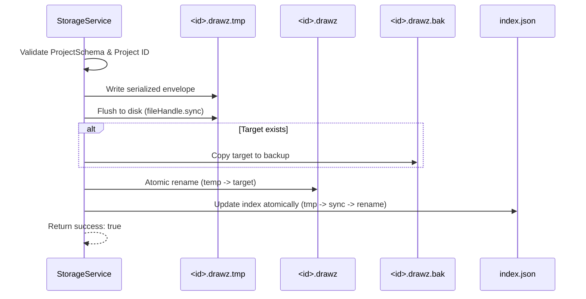

# DATA_DOCUMENT_CONTRACT.md — Drawzware Document & Library Specification

## 1. Overview & Principles

This document defines the canonical file format, data contracts, and library organization for **Drawzware Desktop**.

### Core Invariants

1. **Document-First Envelope:** Standalone project files (`.drawz`) encapsulate domain project data inside a versioned envelope. Domain model changes do not strip or corrupt file metadata.
2. **Offline-First Data Integrity:** Every write operation is atomic and durable (`write-to-temp` -> `sync` -> `backup` -> `rename`).
3. **No Silent Data Loss:** If a project file is invalid or corrupted, it is quarantined (`.corrupted.<timestamp>.json`), not overwritten or discarded. Valid backups (`.drawz.bak`) are checked for automated recovery.
4. **Path Isolation & Strict Sandboxing:** Internal library project IDs are constrained to alphanumeric characters, hyphens, and underscores (`/^[a-zA-Z0-9_-]{1,128}$/`). Arbitrary path traversal is strictly rejected.
5. **Format Recognition:** Drawzware can distinguish and parse canonical `.drawz` envelopes, legacy standalone JSON exports, and web backup bundles without data loss.

---

## 2. Canonical `.drawz` Standalone Document Format

### File Specification

- **Extension:** `.drawz`
- **MIME Type:** `application/vnd.drawzware+json` (fallback: `application/json`)
- **Encoding:** UTF-8 JSON

### Schema Definition

```typescript
export const DRAWZ_FILE_TYPE = 'drawzware-project';
export const CURRENT_DOCUMENT_SCHEMA_VERSION = 1;

export interface DrawzDocument {
  fileType: 'drawzware-project';
  schemaVersion: number;        // Monotonically increasing positive integer (currently 1)
  appVersion?: string;          // Semantic version of writing application (e.g. "0.1.0")
  exportedAt?: string;          // ISO-8601 UTC timestamp
  project: Project;             // Domain project model
}
```

### Domain `Project` Schema

Preserves all active canvas state, diagram-specific modes, nodes, edges, viewport, and metadata:

```typescript
export interface Project {
  id: string;                                // UUID or slug matching PROJECT_ID_REGEX
  name: string;                              // Non-empty human-readable name
  description?: string;                      // Optional text summary
  createdAt: string;                         // ISO-8601 UTC timestamp
  updatedAt: string;                         // ISO-8601 UTC timestamp
  nodes: any[];                              // Active canvas nodes
  edges: any[];                              // Active canvas edges
  viewport: { x: number; y: number; zoom: number }; // Canvas zoom and offset
  diagramType?: 'architecture' | 'sequence' | 'er'; // Current active diagram mode
  diagramData?: Record<string, unknown>;     // Multi-diagram mode state { architecture: ..., sequence: ..., er: ... }
}
```

### Why the Envelope Structure?

In earlier browser exports, projects were exported directly as raw `Project` objects. If a top-level `version` field were placed directly inside the `Project` object, existing domain schema sanitizers or future migrations could strip or overwrite the field. The outer envelope guarantees:
1. `fileType` explicitly identifies the document as a Drawzware project.
2. `schemaVersion` controls file envelope and data migration.
3. If an older desktop build attempts to open a newer `.drawz` file with `schemaVersion > 1`, it immediately detects `UNSUPPORTED_VERSION` and prompts the user to upgrade, preventing silent corruption.

---

## 3. Supported Input Formats & Recognition Matrix

The parser `parseProjectDocument(rawInput)` identifies three distinct inputs:

| Format Type | Discriminator | Handling Strategy |
| :--- | :--- | :--- |
| **Canonical `.drawz`** | `fileType === 'drawzware-project'` | Validates `schemaVersion <= CURRENT`. Parses `project` with `ProjectSchema`. Rejects future schema versions. |
| **Legacy Standalone Project** | Missing `fileType`, has `id`, `name`, `nodes`, `edges` | Validates with `ProjectSchema`. Wraps into a canonical envelope with `schemaVersion = 1`. |
| **Legacy Web Backup Bundle** | Missing `fileType`, has `projects: Project[]`, `version: 1` | Validates against `LegacyAppDataSchema`. Identified as a batch backup bundle for library import. |

---

## 4. Internal Library Storage Architecture

### Directory Layout

The internal library is housed in Electron's sandboxed application user data directory (`app.getPath('userData')`):

```text
userData/
└── library/
    ├── index.json                     # Validated library index
    ├── index.json.bak                 # Previous index backup
    └── projects/
        ├── <id>.drawz                 # Canonical project file
        ├── <id>.drawz.bak             # Prior version backup (created before atomic replace)
        ├── <id>.drawz.tmp.<timestamp> # Temporary write file (cleaned after save)
        └── <id>.corrupted.<ts>.json   # Quarantined corrupted project (if recovery was needed)
```

### Library Index (`library/index.json`)

The index accelerates dashboard rendering without reading all individual `.drawz` files from disk:

```typescript
export interface LibraryIndex {
  version: 1;
  lastOpenedProjectId: string | null;
  projects: LibraryProjectMetadata[];
}

export interface LibraryProjectMetadata {
  id: string;                          // Validated ID matching /^[a-zA-Z0-9_-]{1,128}$/
  name: string;                        // Project title
  description?: string;
  createdAt: string;
  updatedAt: string;
  diagramType?: 'architecture' | 'sequence' | 'er';
  nodeCount: number;
  edgeCount: number;
  fileName: string;                    // "<id>.drawz"
}
```

### Self-Healing & Index Repair

The library index is a derivative cache of the canonical `.drawz` files on disk:
- If `index.json` is missing, invalid, or corrupted, the `StorageService` automatically triggers `repairIndex()`.
- `repairIndex()` scans `library/projects/*.drawz`, parses each file, and reconstructs `index.json` atomically.
- Corrupted files are never indexed; instead, they are quarantined and flagged.

---

## 5. Atomic Persistence Workflow



---

## 6. Migration Roadmap for Future Versions

When schema version 2 is introduced in the future:
1. `CURRENT_DOCUMENT_SCHEMA_VERSION` will be incremented to `2`.
2. A migration function `migrateDocument(doc: DrawzDocument): DrawzDocument` will be registered in `electron/types/document.ts`.
3. If `doc.schemaVersion === 1`, it will be passed through `migrateDocument` before loading into active application state.
4. A backup of the version 1 document will be preserved as `<id>.v1.bak` prior to saving the migrated version.
