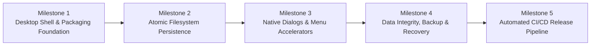

# Drawzware Desktop — Implementation Roadmap & Milestone Plan

**Status:** Proposed Roadmap  
**Author:** Principal Software Engineer & Product Architect  
**Scope:** Ordered Implementation Milestones, Verification Tasks, and Acceptance Criteria  

---

## 1. Roadmap Strategy & Phasing Philosophy

The transformation of Drawzware into a native desktop product follows a strict incremental strategy:



1. **Verify Early:** Prove Electron loads the static `./out` bundle with zero regressions before touching storage logic.
2. **Preserve Working Frontend:** Keep all existing React Flow components, Zustand stores, and hooks functional via adapter interfaces.
3. **Layer Safety Incrementally:** Implement atomic writes, then backup rotation, then recovery dialogs.
4. **Automate Quality Continuously:** Introduce unit and E2E tests before production packaging.

---

## 2. Detailed Milestone Specifications

### Milestone 1: Desktop Shell & Static Packaging Foundation
- **Objective:** Establish the Electron application runtime, enforce sandboxing, and package the static Next.js build.
- **Prerequisites:** Clean repository audit; Next.js `output: "export"` compiling to `./out`.
- **Files / Modules Changed / Created:**
  - `package.json` (add Electron scripts: `dev:electron`, `build:electron`)
  - `electron/main.ts` (NEW: Main process setup, window lifecycle, sandboxing)
  - `electron/preload.ts` (NEW: Minimal contextBridge baseline)
  - `electron/tsconfig.json` (NEW: TypeScript configuration for Node.js main process)
- **Required Implementation Work:**
  1. Install `electron` and `concurrently`/`wait-on` as devDependencies.
  2. Implement `electron/main.ts` creating `BrowserWindow` with `sandbox: true`, `contextIsolation: true`, and `nodeIntegration: false`.
  3. Configure window to load `out/app.html` directly in production, bypassing `out/index.html`.
  4. Add dev script to launch Electron targeting the Turbopack dev server or static build.
- **Acceptance Criteria:**
  - `npm run build && npm run start:electron` opens an application window displaying the Drawzware dashboard.
  - Clicking on a template or project opens the `/canvas?id=...` route successfully without white-screen or console errors.
  - External links open in default OS browser; no new Chromium popups.
- **Validation Commands:**
  ```bash
  npm run build
  npm run build:electron
  npx electron .
  ```
- **Definition of Done:** Packaged Electron shell successfully boots the static frontend with sandboxing verified.
- **Risks & Rollback:**
  - *Risk:* Asset paths in `./out` fail to resolve via `file://`.
  - *Mitigation:* Verify `images: { unoptimized: true }` in `next.config.ts`; use custom protocol (`app://`) if `file://` causes relative URL issues. Rollback is a simple removal of `electron/` directory.

---

### Milestone 2: Atomic Filesystem Persistence Layer
- **Objective:** Replace browser `localStorage` with native filesystem storage using discrete `.drawz` files.
- **Prerequisites:** Milestone 1 complete.
- **Files / Modules Changed / Created:**
  - `electron/types/ipc.ts` (NEW: Strongly typed IPC message contracts)
  - `electron/services/storage.service.ts` (NEW: Atomic filesystem write/read/delete engine)
  - `electron/preload.ts` (Expose `window.desktopApi.project.*`)
  - `src/lib/storage-adapter.ts` (NEW: `IStorageAdapter` interface)
  - `src/lib/desktop-adapter.ts` (NEW: Desktop implementation of `IStorageAdapter`)
  - `src/stores/useProjectStore.ts` (Adopt `IStorageAdapter` for project load/save)
  - `src/hooks/useAutoSave.ts` (Direct autosaves through storage adapter)
- **Required Implementation Work:**
  1. Implement `storage.service.ts` handling `userData/library/projects/` directory and `index.json`.
  2. Implement atomic write protocol: write payload to `.tmp` file, flush with `fs.fdatasync()`, and `fs.rename()` over target.
  3. Implement `DesktopStorageAdapter` in the renderer invoking `window.desktopApi`.
  4. Update `useProjectStore` and `useAutoSave` to asynchronously dispatch saves via the adapter.
- **Acceptance Criteria:**
  - Creating a new project saves an individual `<id>.drawz` file to `%APPDATA%/Drawzware/library/projects/` (or OS equivalent).
  - Editing nodes/edges updates the `.drawz` file within 500 ms of pausing edits.
  - Canvas save status transitions cleanly: `saved` -> `saving` -> `saved`.
  - Storing 50 projects with 100+ nodes succeeds without quota errors.
- **Validation Commands:**
  ```bash
  npm run test:unit
  npm run test:integration
  ```
- **Definition of Done:** Projects save and load from the local disk via atomic IPC with zero reliance on `window.localStorage`.
- **Risks & Rollback:**
  - *Risk:* Asynchronous storage breaks synchronous assumptions in `useProjectStore`.
  - *Mitigation:* Ensure store maintains in-memory state immediately for UI responsiveness, treating filesystem writes as background commitments.

---

### Milestone 3: Native Dialogs & Application Menus
- **Objective:** Eliminate invisible DOM anchor downloads and file inputs in favor of native OS dialogs and menus.
- **Prerequisites:** Milestone 2 complete.
- **Files / Modules Changed / Created:**
  - `electron/menu.ts` (NEW: Application menu bar with keyboard accelerators)
  - `electron/services/dialog.service.ts` (NEW: Native Save/Open dialog handlers)
  - `src/lib/export.ts` (Update export functions to route through native Save dialog)
  - `src/components/project/project-io.ts` (Update file pickers to route through native Open dialog)
  - `src/components/layout/CanvasHeader.tsx` (Wire menu actions to canvas handlers)
- **Required Implementation Work:**
  1. Implement `electron/menu.ts` creating native File, Edit, View, Canvas, Window, and Help menus.
  2. Bind standard accelerators (`CmdOrCtrl+S`, `CmdOrCtrl+O`, `CmdOrCtrl+Z`, `CmdOrCtrl+K`, `F`, `P`).
  3. Connect export engines (PNG, SVG, Mermaid, JSON) to `dialog.showSaveDialog`.
  4. Connect Docker Compose and JSON import to `dialog.showOpenDialog`.
- **Acceptance Criteria:**
  - Exporting a PNG prompts the native OS file picker and writes directly to user-selected path (e.g. `~/Documents/diagram.png`).
  - Selecting "File > Open" opens a native file dialog filtered to `.drawz`, `.json`, `.yaml`, `.yml`.
  - Pressing `CmdOrCtrl+K` triggers the command palette from anywhere in the app.
- **Validation Commands:**
  ```bash
  npm run test:e2e
  ```
- **Definition of Done:** Zero DOM `<a download>` or `<input type="file">` elements invoked when running inside the desktop shell.

---

### Milestone 4: Data Integrity, Backup Rotation & Crash Recovery
- **Objective:** Prevent data loss during power loss or application crashes and provide recovery for damaged files.
- **Prerequisites:** Milestone 3 complete.
- **Files / Modules Changed / Created:**
  - `electron/services/storage.service.ts` (Add backup rotation and quarantine logic)
  - `src/components/project/RecoveryModal.tsx` (NEW: Non-destructive recovery dialog)
  - `src/stores/useProjectStore.ts` (Handle recovery triggers)
- **Required Implementation Work:**
  1. Add automatic `.bak` copy creation before renaming `.tmp` files.
  2. Implement quarantine handler for corrupt JSON files (`<id>.corrupted.<timestamp>.json`).
  3. Create `RecoveryModal` offering one-click restore from `.bak`.
  4. Hook `window.addEventListener('beforeunload')` and `app.on('before-quit')` to flush pending debounced saves.
- **Acceptance Criteria:**
  - If a save process is abruptly terminated, the original project file remains undamaged.
  - Corrupted project files prompt the recovery modal rather than wiping the dashboard.
- **Validation Commands:**
  ```bash
  npm run test:integration -- -t "Recovery"
  ```
- **Definition of Done:** Comprehensive crash resilience verified with automated recovery tests.

---

### Milestone 5: Automated Cross-Platform Packaging & CI/CD
- **Objective:** Package production installers for Windows, macOS, and Linux and automate releases via GitHub Actions.
- **Prerequisites:** Milestone 4 complete; all test suites passing.
- **Files / Modules Changed / Created:**
  - `electron-builder.yml` (NEW: Installer configurations for NSIS, DMG, AppImage, deb)
  - `.github/workflows/release.yml` (NEW: Multi-platform release matrix)
  - `package.json` (add packaging scripts: `package:win`, `package:mac`, `package:linux`)
- **Required Implementation Work:**
  1. Install `electron-builder` as devDependency.
  2. Configure `electron-builder.yml` with app metadata, icons, file associations (`.drawz`), and artifact naming.
  3. Author `.github/workflows/release.yml` executing lint, typecheck, tests, build, and packaging across `windows-latest`, `macos-latest`, and `ubuntu-latest`.
  4. Configure GitHub Releases publishing on tag push (`v*`).
- **Acceptance Criteria:**
  - Pushing a release tag triggers GitHub Actions matrix producing `.exe`, `.dmg`, and `.AppImage` artifacts.
  - Binaries install cleanly on target operating systems and launch directly to `/app`.
- **Validation Commands:**
  ```bash
  npx electron-builder --dir
  ```
- **Definition of Done:** Full release automation operational with downloadable cross-platform installers attached to GitHub Releases.
