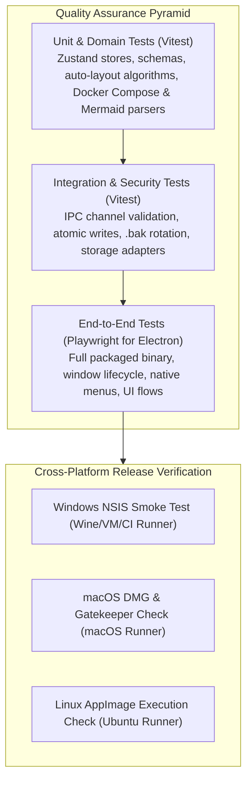
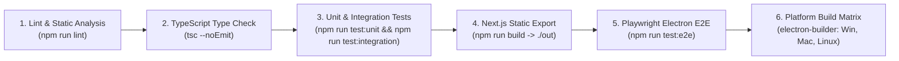

# Drawzware Desktop — Test & Quality Assurance Strategy

**Status:** Proposed Strategy  
**Author:** Principal Software Engineer & Product Architect  
**Scope:** Test Frameworks, Unit, Integration, IPC Security, E2E, Performance, and CI Quality Gates  

---

## 1. Quality Philosophy and Test Objectives

The primary objective of this testing strategy is to guarantee that transforming Drawzware into a desktop application introduces zero regressions to the existing diagramming experience, guarantees 100% data durability under unexpected system failures, and maintains rigorous security boundaries.

### Current Repository State (Audited):
- **Current Quality Gates:** `npm run lint` ([eslint.config.mjs](file:///d:/AI%20Projects/drawzware-system-design-canvas/eslint.config.mjs)) and `npm run build` ([next.config.ts](file:///d:/AI%20Projects/drawzware-system-design-canvas/next.config.ts)).
- **Automated Test Coverage:** Currently **0%** (no test runners or test files exist in the repository).
- **CI Status:** [.github/workflows/ci.yml](file:///d:/AI%20Projects/drawzware-system-design-canvas/.github/workflows/ci.yml) executes only `npm ci`, `npm run lint`, and `npm run build` on Node 20 and 22.

---

## 2. Test Architecture & Tooling



### Selected Frameworks:
1. **Unit & Integration:** `vitest` (fast, native TypeScript/ESM execution, zero-config matching Next.js tsconfig paths).
2. **E2E Desktop Automation:** `@playwright/test` using Playwright's first-class Electron automation API (`_electron.launch`).

---

## 3. Test Layers and Detailed Test Specifications

### Layer 1: Unit & Domain Logic Tests (Vitest)
*Execution: `npm run test:unit` (< 5 seconds total run time).*

| Suite | Target File | What the Test Proves |
|---|---|---|
| **Project Schema Validation** | `src/types/index.ts` | Validates that `ProjectSchema` correctly parses complete and partial project payloads; guarantees sensible defaults for `viewport` and `diagramType`. |
| **Zustand Project Store** | `src/stores/useProjectStore.ts` | Proves that project CRUD actions (`createProject`, `duplicateProject`, `renameProject`, `deleteProject`, `mergeProjects`) correctly mutate in-memory state and call the storage adapter. |
| **Zustand Canvas Store** | `src/stores/useCanvasStore.ts` | Proves that `addNode`, `deleteNode`, `onConnect`, `duplicateNodes`, and undo/redo stacks operate correctly without state corruption. |
| **Dagre Graph Auto-Layout** | `src/lib/auto-layout.ts` | Proves that `getLayoutedElements()` computes valid non-overlapping coordinates for complex directed node graphs without dropping nodes or edges. |
| **Docker Compose Import** | `src/lib/docker-compose.ts` | Proves that `parseDockerCompose()` maps services (Postgres, Redis, Nginx, Kafka) to their exact corresponding node types, protocols, and default tech tags. |
| **Mermaid Code Generation** | `src/lib/mermaid.ts` | Proves that `exportToMermaid()` outputs syntactically valid Mermaid flowchart code matching standard syntax rules. |

---

### Layer 2: Persistence & IPC Security Integration Tests (Vitest)
*Execution: `npm run test:integration` (runs headless against a temporary sandbox filesystem).*

| Suite | Target File | What the Test Proves |
|---|---|---|
| **Atomic Staging Protocol** | `electron/services/storage.ts` | Proves that writes write to `.tmp`, flush to disk, copy to `.bak`, and rename atomically. Proves that original data is never corrupted if a write aborts midway. |
| **Corrupted File Quarantine** | `electron/services/storage.ts` | Proves that reading a malformed JSON file renames it to `.corrupted.<timestamp>.json`, loads the `.bak` fallback, and never resets storage to empty. |
| **IPC Argument Validation** | `electron/main.ts` | Proves that the main process rejects malformed payloads, non-string IDs, or path traversal attacks (e.g. `../../etc/passwd`). |
| **Desktop Storage Adapter** | `src/lib/desktop-adapter.ts` | Proves that `DesktopStorageAdapter` correctly translates UI store actions into typed `window.desktopApi` calls. |

---

### Layer 3: End-to-End User Journey Tests (Playwright for Electron)
*Execution: `npm run test:e2e` (launches actual Electron binary).*

```typescript
// Example Playwright Electron Test Pattern
import { test, expect, _electron as electron } from '@playwright/test';

test('App boots directly to /app dashboard and creates new project', async () => {
  const electronApp = await electron.launch({ args: ['.'] });
  const window = await electronApp.firstWindow();
  
  // Assert window URL does not contain marketing page
  expect(window.url()).toContain('/app');
  await expect(window.locator('text=Projects')).toBeVisible();
  
  // Click new project
  await window.click('button:has-text("New project")');
  await expect(window.locator('.react-flow')).toBeVisible();
  
  await electronApp.close();
});
```

| Suite | Critical User Journey | Acceptance Threshold |
|---|---|---|
| **Direct Boot Journey** | Launch app; verify window renders `/app` dashboard; assert marketing landing page `/` is never shown. | Window ready in < 1,500 ms; no FOUT. |
| **Canvas Lifecycle Journey** | Open project; drag Service node and Redis Cache node from palette; connect via TCP edge; verify save status changes from `Saving…` to `Saved`. | Diagram state saved to disk within 600 ms of last action. |
| **High-DPI Export Journey** | Open diagram; click Export > PNG (2x); assert native save dialog is triggered; confirm generated PNG file has valid PNG magic bytes (`\x89PNG`). | Valid image generated; zero UI errors. |
| **Offline Resilience** | Launch with network completely disabled; perform full edit and export cycle. | 100% functionality; zero network exceptions in console. |
| **Crash Recovery Journey** | Edit diagram; simulate process kill (`SIGKILL`); restart app; verify recovery banner appears and restores changes from backup. | Zero data loss of completed edits. |

---

### Layer 4: Large-Project Performance Benchmarks
*Execution: Automated benchmark script.*

- **Test Scenario:** Generate a synthetic architecture diagram with **300 nodes** and **500 edges** including custom shapes and freehand drawing paths.
- **Metrics Collected:**
  1. *Canvas Frame Rate:* Pan and zoom under 60 fps profiling.
  2. *Autosave Write Latency:* Background IPC serialization and file write must complete in < 50 ms.
  3. *Memory Consumption:* Heap size must not exceed 250 MB after 10 minutes of active manipulation.

---

## 4. CI/CD Pipeline Quality Gates

The updated GitHub Actions workflow will enforce strict sequential gates before any release binary can be generated:



### Absolute Rule for AI Coding Agents:
> **Never claim a test has passed without running it.** If a test cannot be executed due to environment or runner constraints, explicitly report that it was not executed and document the reason.
