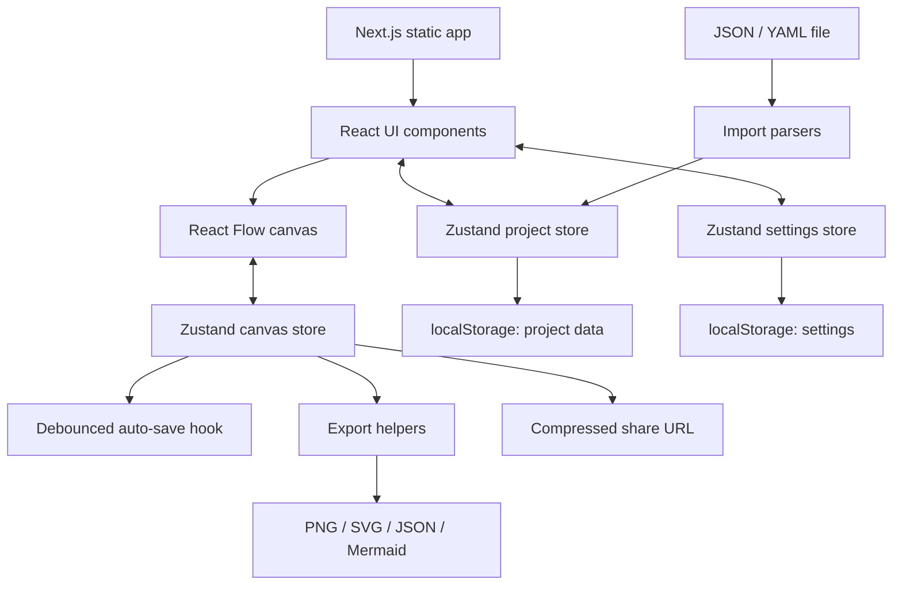

# System Design Canvas — Project Analysis Notes

## 1. Executive summary

**System Design Canvas is a browser-based visual editor for planning software system architecture.** It lets a user put infrastructure blocks on a canvas, connect them with named protocols, add implementation details, inspect simple design warnings, arrange the diagram automatically, and export or share the result.

The application is intended for system-design practice, architecture discussions, technical planning, and documentation. It is a visual modelling tool, not a service that deploys infrastructure or runs the architecture being drawn.

The central product idea is to provide an opinionated diagramming canvas: rather than starting with thousands of generic shapes, users get common system-design elements such as clients, load balancers, API gateways, application services, databases, caches, queues, streams, storage, and monitoring.

### Main findings

- **Frontend:** Next.js App Router, React, and TypeScript.
- **Diagram engine:** React Flow (`@xyflow/react`).
- **Client-side state:** Zustand.
- **Persistence:** browser `localStorage`; there is no project backend or database in this repository.
- **Styling:** Tailwind CSS v4, Radix-based UI primitives, and a custom light/dark token system called “Studio”.
- **Architecture features:** custom nodes and edges, editable node/edge metadata, templates, design checks, auto-layout, undo/redo, keyboard commands, presentation mode, import, export, URL sharing, and cross-origin project migration.
- **Deployment model:** Next.js static export to `out/`, served from a static host such as Vercel or Cloudflare Workers.
- **CI:** GitHub Actions runs dependency installation, ESLint, and a production build for Node 20 and Node 22. The archive does not contain a test suite or test command.

## 2. What problem does it solve?

System architecture is often sketched on a whiteboard or drawn in a generic diagram tool. This app gives the user a structured canvas where the shapes and connections already mean something in software architecture.

A typical use case:

1. Create a project, or choose a template such as Microservices or Event-Driven.
2. Add components from the library, for example an API Gateway, Service, PostgreSQL Database, Redis Cache, and Kafka Stream.
3. Connect components and choose a protocol such as REST, gRPC, DB Query, or Pub/Sub.
4. Edit each node's name, tech stack, description, status, environment, owner, links, and presentation story.
5. Run automatic layout and inspect warnings about disconnected or potentially suspicious components.
6. Present the diagram, export it, save a backup, or share a link that another person can open as a new local project.

## 3. What it does and does not do

### It does

- Draw and edit architecture diagrams in the browser.
- Store projects and settings in browser storage.
- Provide templates for common architectures.
- Represent component relationships with typed connections.
- Add optional details to components and connections.
- Offer heuristic checks; these are guidance, not proof that a design is correct.
- Export visual images and architecture data.
- Convert supported Docker Compose files or supported endpoint-list JSON into diagrams.
- Transfer projects between deployments using a compressed URL payload.

### It does not

- Deploy services, containers, databases, or cloud infrastructure.
- Execute or simulate requests through the diagram.
- Measure real latency, throughput, availability, or system performance. Those fields are descriptive metadata entered by the user.
- Provide user accounts, a remote database, server-side project storage, or automatic cross-device sync.
- Provide real-time multi-user collaboration.
- Guarantee that an architecture is scalable, secure, fault-tolerant, or production-ready. The design checks are deliberately simple heuristics.

## 4. Main features

### Diagram editing

- Drag-and-drop library of architecture components.
- Create components by clicking a library item or using quick-add/command menus.
- Custom renderers for standard components, grouping frames, and sticky notes.
- Draw and reconnect edges between nodes.
- Select, duplicate, group, align, lock, reorder, copy, paste, and delete elements.
- Reverse the direction of an existing connection.
- Support for undo/redo with a bounded history of up to 50 saved diagram states.
- Zoom, pan, fit-to-view, optional snap-to-grid, and optional minimap.
- Floating editors on wide layouts; drawer/bottom-sheet behavior on narrow screens.

### Component data

Nodes can hold:

- Name/label and component type.
- Description.
- Tech stack, with suggested choices by component type.
- Optional status: operational, degraded, down, or maintenance.
- Optional environment: production, staging, or development.
- Optional owner/team.
- Optional related links.
- Optional `story` text shown in presentation mode.

### Connection data

Connections have a type and can include a label, description, latency, data format, and throughput. These values document the intended architecture; they are not live telemetry.

### Design checks

`src/lib/validation.ts` currently checks for:

- System components that have no connections.
- Components with four or more connections, treated as a possible bottleneck unless the node is a load balancer or API gateway.
- Missing tech-stack values on databases, caches, queues, load balancers, and CDNs.
- A database with outgoing connections but no incoming connections.

Warnings are heuristic. The app cannot infer real capacity, workload, traffic direction correctness, or actual service health from a diagram alone.

### Layout and presentation

- Automatic arrangement uses Dagre.
- Layout attempts to orient connection handles toward each other.
- Async protocols are handled differently in layout ranking so event-driven connections do not always push a node into a later row.
- Presentation mode walks the graph one component at a time, emphasizes the current component and its neighbours, and displays the optional story text.

### Import and export

- **PNG/SVG:** render the React Flow canvas through `html-to-image`; PNG supports scale settings and optional transparent background.
- **Diagram JSON:** exports node and edge data so a canvas can be re-imported.
- **Mermaid:** emits a Mermaid flowchart representation.
- **Project JSON:** dashboard-level export can include a complete project or all projects.
- **Docker Compose YAML:** maps recognised image names to likely component types and infers relationships from `depends_on` and legacy `links`.
- **Endpoint JSON:** recognises endpoint arrays or wrapper properties named `endpoint_list`, `endpoints`, or `endpointList`; it groups endpoints by host and inferred resource/service.

Import heuristics can only infer what is available in the input. Unknown container images usually become generic services; detected technologies and connection types may need manual correction.

### Share and move data

- Share links compress the diagram's nodes and edges with `lz-string` and put the payload in a URL query parameter.
- A recipient sees a preview and can save a new copy in their browser. It does not edit or update the sender's original project.
- Cross-deployment migration packs projects, settings, and the onboarding flag into a compressed URL hash. The receiver merges projects while skipping IDs that already exist.
- Migration payloads that exceed the configured URL length threshold fall back to a JSON backup download.

**Privacy clarification:** normal project editing is local-only and the app does not have a project API or backend. However, sharing or migrating deliberately places project data into a URL. That URL transfers the encoded data when the user shares or opens it, so users should avoid putting sensitive internal architecture information in a link they do not want others to see.

## 5. Architecture and data flow

### High-level design



### Runtime flow for editing

1. The dashboard loads project data from `localStorage` through `useProjectStore` and `src/lib/storage.ts`.
2. Opening `/canvas?id=<id>` loads the selected project's nodes, edges, and viewport into `useCanvasStore`.
3. React Flow runs in **controlled mode**: the nodes and edges held by Zustand are the source of truth. Change handlers write diagram changes to the store.
4. `useAutoSave` observes nodes, edges, viewport, and project ID. It saves after a 500 ms debounce, flushes on page unload, and retries a failed storage write every three seconds.
5. The project store serialises the updated project into `localStorage`.

### Main data stores

| Store | Responsibility | Persistence |
|---|---|---|
| `useCanvasStore` | Active canvas nodes/edges/viewport, selection, pending connection, undo/redo history, clipboard, dialogs, presentation state, save status | Active canvas is written to the project store by `useAutoSave`; temporary UI state is in memory |
| `useProjectStore` | Create, load, rename, duplicate, delete, restore, import, merge, and save projects | `system-design-canvas` key through `src/lib/storage.ts` |
| `useSettingsStore` | Theme, snap-to-grid, minimap, design checks, animated edges, hydration status | `sdc.settings` through Zustand persist middleware |
| `useToastStore` | Temporary success/info/error notifications and optional actions | Memory only; up to three visible toast entries |

### Browser storage keys

- `system-design-canvas`: versioned project data, project list, and last-opened project ID.
- `sdc.settings`: persisted appearance and canvas preferences.
- `sdc.onboarded`: onboarding completion marker.
- `system-design-canvas-theme` and `sdc-onboarding-seen`: legacy keys used during preference migration.

Browser storage is per origin and has browser-dependent limits. Clearing browser storage can remove project data unless it has been exported or otherwise backed up.

## 6. Routes / pages

| Route | Purpose | Notes |
|---|---|---|
| `/` | Dashboard and project home | Project list, search/sort, project actions, templates, imports, and possible migration banner |
| `/canvas?id=<projectId>` | Architecture editor | The ID is a query parameter so the app can be statically exported; the route does not use a dynamic path segment |
| `/canvas/shared?d=<payload>` | Shared-design preview | Decodes compressed nodes and edges, previews a minimap and counts, then saves a new copy locally |
| `/settings` | Settings | Appearance, canvas behavior, data import/export/clear, and app/about information |
| `/import#<payload>` | Cross-origin migration receiver | Decodes transferred projects from the URL hash and merges them into local storage |

`vercel.json` redirects older `/canvas/<id>` links to `/canvas?id=<id>`, excluding the shared route. The root layout defines site metadata and handles initial theme selection before the page paints.

## 7. Data model

### Component types

There are 19 infrastructure/component types plus the `group` type in `SystemNodeType`:

- Client and edge: `client`, `cdn`, `dns`, `waf`, `load-balancer`, `api-gateway`
- Compute: `service`, `worker`, `serverless`, `container-cluster`
- Data: `database`, `cache`, `object-storage`, `search-index`
- Async: `queue`, `stream`, `scheduler`
- Observability: `logging`, `monitoring`
- Other: `group`

Sticky notes use the React Flow node renderer type `note`; their data is shaped to fit the general node data type, but `note` itself is not a value in `SystemNodeType`.

### Connection types

`rest`, `grpc`, `graphql`, `websocket`, `pub-sub`, `mqtt`, `event-stream` (shown as SSE), `tcp`, and `db-query`.

### Core fields

- **SystemNodeData:** `label`, `nodeType`, optional `description`, optional `story`, `techStack[]`, optional status, environment, owner, and links.
- **SystemEdgeData:** `edgeType`, optional `label`, `description`, `latency`, `dataFormat`, and `throughput`.
- **Project:** `id`, `name`, optional description, `createdAt`, `updatedAt`, `nodes`, `edges`, and a viewport `{ x, y, zoom }`.
- **AppData:** `version`, `projects[]`, and `lastOpenedProjectId`.

`src/types/index.ts` defines Zod schemas and TypeScript types. It performs useful top-level validation, but `ProjectSchema` currently uses `z.array(z.any())` for `nodes` and `edges`, so individual nested nodes and edges are not deeply validated at the project schema boundary.

## 8. Tech stack and what each major dependency is for

| Technology/package | Role in this project |
|---|---|
| Next.js 16 App Router | Page routing, app shell, metadata, and static export build |
| React 19 | Component model and UI rendering |
| TypeScript | Typed component, store, and diagram models |
| `@xyflow/react` | Interactive node/edge canvas, selections, handles, viewport, minimap, drag/drop |
| Zustand | Lightweight global stores for canvas, projects, settings, and toasts |
| Tailwind CSS v4 | Utility-first styling |
| Radix UI / `radix-ui` | Accessible interaction primitives behind custom dialogs, menus, popovers, sheets, and tooltips |
| `class-variance-authority`, `clsx`, `tailwind-merge` | Component variants and conditional/merged class names |
| `lucide-react` | Icons for node types, controls, and menu items |
| `@dagrejs/dagre` | Graph-based automatic layout |
| `html-to-image` | Canvas image rendering for PNG and SVG export |
| `lz-string` | Compression for share and migration URL payloads |
| `js-yaml` | Parse Docker Compose YAML files |
| `zod` | Runtime validation for persisted project/schema data |
| `tw-animate-css` | Motion utility styles |
| `wrangler` | Cloudflare Workers static asset deployment |
| `eslint`, `eslint-config-next` | Lint checks |
| `typescript`, React/Node/YAML/LZ type packages | TypeScript development and type support |
| `shadcn` | UI component/tooling configuration; the repository also contains its own `src/components/ui` primitives |

Exact declared dependency ranges are in `package.json`; the npm lockfile is version 3 and records resolved dependency versions.

## 9. Directory structure

```text
system-design-canvas-main/
├── .github/workflows/ci.yml
├── .gitignore
├── CLAUDE.md
├── LICENSE
├── README.md
├── components.json
├── eslint.config.mjs
├── next.config.ts
├── package.json
├── package-lock.json
├── postcss.config.mjs
├── tsconfig.json
├── vercel.json
├── wrangler.jsonc
├── public/
│   ├── file.svg
│   ├── globe.svg
│   ├── next.svg
│   ├── vercel.svg
│   ├── window.svg
│   └── screenshots/
│       ├── canvas-dark.png
│       ├── canvas-light.png
│       ├── dashboard-dark.png
│       ├── dashboard-light.png
│       └── presentation-light.png
└── src/
    ├── app/
    │   ├── layout.tsx
    │   ├── page.tsx
    │   ├── globals.css
    │   ├── favicon.ico
    │   ├── canvas/
    │   │   ├── layout.tsx
    │   │   ├── page.tsx
    │   │   └── shared/layout.tsx + page.tsx
    │   ├── import/layout.tsx + page.tsx
    │   └── settings/layout.tsx + page.tsx
    ├── components/
    │   ├── canvas/       # Canvas composition and editor controls
    │   ├── edges/        # Custom connection renderer/editors/registries
    │   ├── layout/       # Dashboard/canvas headers
    │   ├── nodes/        # Custom node renderers/editor/registry
    │   ├── project/      # Project cards, dialogs, templates, import/export
    │   ├── shared/       # Shared visual helpers
    │   ├── ui/           # Reusable design-system primitives
    │   └── providers.tsx
    ├── hooks/            # Auto-save, shortcuts, theme, media query
    ├── lib/              # Persistence, import/export, layout, validation, utilities
    ├── stores/            # Zustand state stores
    ├── styles/tokens.css  # Studio design tokens
    └── types/index.ts     # Types and Zod schemas
```

## 10. File-by-file guide

The descriptions below are based on the included source and configuration files. `package-lock.json` is the generated dependency-resolution file, so it is not a handwritten application module.

### Root files and build/deployment configuration

| File | Responsibility |
|---|---|
| `README.md` | Product description, user-facing features, templates, shortcuts, setup, stack, and deployment guide. |
| `CLAUDE.md` | Contributor/AI-coding guidance. Documents the architecture, design-system rules, data model, registry conventions, and template patterns. Read this before changing the code. |
| `package.json` | Project identity, scripts, direct runtime dependencies, and dev dependencies. Declares `dev`, `build`, `start`, `lint`, and `deploy:cloudflare` scripts. |
| `package-lock.json` | Exact npm dependency tree and resolved versions; supports reproducible `npm ci` installs. |
| `LICENSE` | MIT license; copyright notice is included in the file. |
| `.gitignore` | Excludes dependency folders, Next.js build output, static output, env files, debug logs, Vercel/Cloudflare local files, and TypeScript build artifacts. |
| `next.config.ts` | Enables `output: "export"` and disables Next image optimization for static hosting. |
| `components.json` | shadcn configuration: CSS path, aliases, Tailwind setup, icon library, and component style preset. |
| `eslint.config.mjs` | Enables Next.js Core Web Vitals and TypeScript ESLint configurations and ignores build artifacts. |
| `postcss.config.mjs` | Wires Tailwind CSS v4 through `@tailwindcss/postcss`. |
| `tsconfig.json` | TypeScript strict settings, bundler module resolution, React JSX transform, Next plugin, and `@/*` alias to `src/*`. |
| `vercel.json` | Redirects legacy `/canvas/:id` URLs to the query-param canvas route. |
| `wrangler.jsonc` | Cloudflare Workers static asset settings; serves the `out` directory and configures missing-page handling. |
| `.github/workflows/ci.yml` | Runs on pushes and pull requests to `main`; tests Node 20 and 22, runs `npm ci`, `npm run lint`, and `npm run build`. Despite the job name, there is no separate unit-test step in this workflow. |

### Static assets

| File | Responsibility |
|---|---|
| `public/file.svg` | Static SVG illustration/icon asset. |
| `public/globe.svg` | Static globe SVG asset. |
| `public/next.svg` | Next.js SVG logo asset. |
| `public/vercel.svg` | Vercel SVG logo asset. |
| `public/window.svg` | Static window SVG asset. |
| `public/screenshots/dashboard-light.png` | README screenshot of the dashboard in light theme. |
| `public/screenshots/dashboard-dark.png` | README screenshot of the dashboard in dark theme. |
| `public/screenshots/canvas-light.png` | README screenshot of the canvas in light theme. |
| `public/screenshots/canvas-dark.png` | README screenshot of the canvas in dark theme. |
| `public/screenshots/presentation-light.png` | README screenshot of presentation mode. |
| `src/app/favicon.ico` | Browser tab favicon. |

### App routes and app shell

| File | Responsibility |
|---|---|
| `src/app/layout.tsx` | Root HTML layout, Geist fonts, site metadata/Open Graph metadata, global CSS, initial theme script, and `Providers`. |
| `src/app/page.tsx` | Main dashboard composition: header, project list, file drop/import experience, and optional migration banner. |
| `src/app/globals.css` | Tailwind imports, token-to-utility mapping, focus states, dot grid, motion animations, reduced-motion handling, and React Flow overrides. |
| `src/app/canvas/layout.tsx` | Canvas route metadata and a thin layout wrapper. |
| `src/app/canvas/page.tsx` | Reads `id` from query parameters, resolves the requested project, and renders the canvas or a missing-project state. Uses Suspense around search-parameter access for static app compatibility. |
| `src/app/canvas/shared/layout.tsx` | Metadata/layout wrapper for the shared-design page. |
| `src/app/canvas/shared/page.tsx` | Decodes `d` from a share URL, displays a diagram preview and counts, and creates a new local project when the recipient chooses to open it. |
| `src/app/import/layout.tsx` | Metadata/layout wrapper for the migration import route. |
| `src/app/import/page.tsx` | Reads the URL hash client-side, previews migrated projects, merges project IDs not already present, applies preferences when appropriate, then clears the payload from the visible URL/history. |
| `src/app/settings/layout.tsx` | Metadata/layout wrapper for settings. |
| `src/app/settings/page.tsx` | Settings interface with Appearance, Canvas, Data, and About sections; handles theme/preferences, project backup import/export, and clearing project data. |

### `src/components/canvas/` — main diagram editor

| File | Responsibility |
|---|---|
| `Canvas.tsx` | Main canvas orchestrator. Registers custom node/edge types, connects React Flow to Zustand, loads a project, handles connection/drag/selection events, applies preferences, computes validation/presentation state, and mounts editor panels and dialogs. |
| `AddComponentMenu.tsx` | Context-menu submenu for adding components grouped by registry category. |
| `CanvasContextMenu.tsx` | Context menus for the canvas pane, individual nodes, and selections; exposes creation, layout/selection, duplicate, grouping, and delete actions. |
| `CanvasToolbar.tsx` | Floating toolbar for canvas actions such as view control, layout, settings-dependent actions, selection operations, and clearing the canvas. |
| `CommandMenu.tsx` | Searchable command palette opened by Cmd/Ctrl+K; combines add-component commands, diagram actions, navigation, and project jumps. |
| `EmptyCanvas.tsx` | First-use empty state with quick-add component choices. |
| `ExportDialog.tsx` | Export UI for PNG/SVG/JSON/Mermaid; supports relevant output settings, preview/copy/download actions, and notifications. |
| `NodePalette.tsx` | Searchable component library; supports category grouping, drag/drop, collapsed rail, and responsive bottom-sheet layout. |
| `OnboardingOverlay.tsx` | First-use walkthrough stored in browser state; explains basic library, connection, and editing interactions. |
| `PresentationOverlay.tsx` | Presentation controls/cards; shows one graph component at a time and navigates through the presentation order. |
| `SelectionActions.tsx` | Floating multi-selection action bar for operations on selected nodes. |
| `ShareDialog.tsx` | Builds a compressed share URL, shows link-size guidance, and lets the user copy the link. |
| `ShortcutsDialog.tsx` | Displays the keyboard shortcuts from the shared shortcut definitions. |
| `ValidationPanel.tsx` | Shows validation issues and can direct attention to components with warnings. |
| `canvas-helpers.ts` | Shared canvas helpers for fitting the view, calculating placement, presentation order, and shortcut/action behaviors used by editor controls. |

### `src/components/nodes/` — node rendering and editing

| File | Responsibility |
|---|---|
| `BaseSystemNode.tsx` | One reusable renderer for ordinary infrastructure components; pulls icon/label/color from the node registry and displays optional status/environment/tech metadata plus connection handles. |
| `GroupNode.tsx` | Separate renderer for a group/frame that visually encloses related elements. |
| `StickyNote.tsx` | Separate renderer for free-form notes on the canvas. |
| `NodeEditor.tsx` | Floating panel/drawer for editing a selected node's name, type, tech stack, description, presentation story, status, environment, owner, and links. |
| `node-registry.ts` | Central mapping of each node type to its label, icon, visual accent, category, default technology stack, and suggested technologies. |

### `src/components/edges/` — connections

| File | Responsibility |
|---|---|
| `SystemEdge.tsx` | Custom React Flow edge renderer; displays protocol-specific styling/labels and offers inline editing/picking interactions. |
| `edge-registry.ts` | Central labels, colors, dash styles, and animation settings for the nine connection types. |
| `ProtocolPicker.tsx` | Protocol selection UI used to choose/change an edge type. |
| `ConnectionTypePicker.tsx` | UI for picking a connection type immediately after connecting two nodes. |
| `EdgeEditor.tsx` | Floating panel/drawer to edit edge type and descriptive metadata such as label, description, latency, data format, and throughput. |

### `src/components/layout/`, `project/`, `shared/`, and providers

| File | Responsibility |
|---|---|
| `src/components/layout/Header.tsx` | Shared dashboard/settings header and entry points for importing files. |
| `src/components/layout/CanvasHeader.tsx` | Canvas breadcrumb/project rename, saved-state indicator, present/export/share buttons, and theme control. |
| `src/components/providers.tsx` | Client provider layer; hydrates persisted preferences, applies theme, and mounts tooltips/toaster. |
| `src/components/shared/MinimapThumb.tsx` | Small SVG-based preview of a diagram, used for project/share/migration previews. |
| `src/components/project/ProjectList.tsx` | Dashboard's project listing, search/sort and empty/no-result states, and project-level actions. |
| `src/components/project/ProjectCard.tsx` | A single project card with diagram thumbnail and actions. |
| `src/components/project/ProjectModal.tsx` | Modal for creating or editing project metadata. |
| `src/components/project/DeleteProjectDialog.tsx` | Project deletion confirmation dialog. |
| `src/components/project/ConfirmDialog.tsx` | Reusable confirmation dialog for potentially destructive actions. |
| `src/components/project/TemplateSelector.tsx` | UI for choosing a starter template. |
| `src/components/project/TemplateStrip.tsx` | Compact template selector/strip shown on the dashboard. |
| `src/components/project/ImportDropZone.tsx` | Drag/drop target for importing supported files on the dashboard. |
| `src/components/project/MigrationBanner.tsx` | Announces a configured destination deployment and lets users package local data for migration. |
| `src/components/project/project-io.ts` | Shared project file operations: picker, import routing, error notifications, template creation, component counts, and single/all-project JSON export. |
| `src/components/project/useProjectImport.ts` | Hook that connects dashboard import controls to file import and UI state. |

### `src/components/ui/` — reusable UI primitives

These are the app's own styled primitives and wrappers. Most use the shared `cn` helper and the Studio token system.

| File | Responsibility |
|---|---|
| `button.tsx` | Button primitive with variants and sizes. |
| `context-menu.tsx` | Context-menu wrappers built on Radix primitives. |
| `dialog.tsx` | Modal dialog wrappers and content/header/title/close patterns. |
| `dropdown-menu.tsx` | Dropdown and submenu primitives. |
| `input.tsx` | Input, textarea, search input, and input style variants. |
| `kbd.tsx` | Keyboard-key and key-combination display; formats platform-specific modifier labels. |
| `label.tsx` | Form labels and field wrapper. |
| `panel.tsx` | Panel/header/body/footer components and icon-chip styling. |
| `popover.tsx` | Popover wrappers. |
| `segmented.tsx` | Segmented-choice control for preferences and export options. |
| `sheet.tsx` | Side drawer/sheet wrappers based on dialog primitives. |
| `switch.tsx` | Toggle switch. |
| `tag.tsx` | Tag/chip styles and suggestion tags. |
| `toast.tsx` | Toast renderer; subscribes to the toast store and manages dismiss/timeout presentation. |
| `tooltip.tsx` | Tooltip provider/wrappers and a shortcut-aware simple tooltip. |

### `src/hooks/` — reusable React behavior

| File | Responsibility |
|---|---|
| `useAutoSave.ts` | Debounced persistence of the active canvas, a before-unload flush, save status updates, and retry after failed writes. |
| `useKeyboardShortcuts.ts` | Registers global canvas shortcuts while respecting typing targets, dialogs/menus, and presentation state. |
| `useMediaQuery.ts` | React hook around browser media queries; `useIsNarrow` provides the responsive breakpoint used by the canvas. |
| `useTheme.ts` | Resolves light/dark/system preferences, reacts to OS theme changes, toggles theme, and updates `data-theme` on the document. |

### `src/lib/` — domain logic and utilities

| File | Responsibility |
|---|---|
| `storage.ts` | Reads/writes the versioned project store in localStorage, checks saved data with Zod, reports storage size, clears the key, and provides a migration hook for future schema versions. |
| `routes.ts` | Builds the query-parameter canvas URL (`/canvas?id=...`) required for static export. |
| `templates.ts` | Defines the nine starter architecture templates as plain node/edge data. |
| `node-factory.ts` | Creates new typed components/groups and sticky-note objects with IDs, default labels, positions, and default tech stacks. |
| `auto-layout.ts` | Uses Dagre to arrange ordinary component nodes and reorient edge handles; groups and sticky notes retain their positions. |
| `minimap.ts` | Calculates node rectangles, diagram bounds, connection handle points, and minimap colors. |
| `validation.ts` | Computes the heuristic design issues described earlier and exposes a context hook for warning indicators. |
| `share.ts` | Compresses/decompresses nodes and edges in share URLs and calculates URL byte length for warning display. |
| `migration.ts` | Builds/decodes cross-origin migration hash payloads; filters imported projects through `ProjectSchema`; carries settings and onboarding state. |
| `export.ts` | Renders PNG/SVG, calculates export bounds and image dimensions, copies PNG to clipboard, creates JSON export data, and provides a JSON-import helper. |
| `json-import.ts` | Recognises project JSON, multi-project backup JSON, and API endpoint-list JSON; creates endpoint diagrams and applies auto-layout. |
| `docker-compose.ts` | Parses Compose YAML, infers component types/tech stacks from image names, creates dependency edges, and runs auto-layout. |
| `mermaid.ts` | Converts the canvas node/edge graph to a Mermaid flowchart string. |
| `shortcuts.ts` | Single source of truth for keyboard shortcut groups/labels used by the shortcut dialog and command palette. |
| `utils.ts` | Shared class merging, color tint/edge styling, platform detection, byte formatting, pluralisation, downloads, and relative-date formatting. |

### `src/stores/`, `src/types/`, and `src/styles/`

| File | Responsibility |
|---|---|
| `src/stores/useCanvasStore.ts` | Active diagram state and operations: controlled React Flow changes, connect/edit/delete/reverse, copy/paste/duplicate, group/align/lock/ordering, selection, viewport, presentation, and bounded undo/redo history. |
| `src/stores/useProjectStore.ts` | Project CRUD, load/save, duplicate/restore, single/multiple imports, export string, merge logic, and full project-data clearing. |
| `src/stores/useSettingsStore.ts` | Zustand-persisted user preferences and one-time hydration, including migration from the legacy theme key. |
| `src/stores/useToastStore.ts` | Toast queue, action callback model, unique toast IDs, and the maximum-three-toast rule. |
| `src/types/index.ts` | Node/edge enums, node and edge schemas, project/app-data schemas, React Flow aliases, and default viewport. |
| `src/styles/tokens.css` | Studio design tokens, with light values on root/light theme and alternate values under `[data-theme="dark"]`. |

## 11. Templates included

1. **Microservices:** Client → Load Balancer → API Gateway → Services → databases/queue.
2. **Monolith:** Client → Load Balancer → Monolith → database/cache.
3. **Event-Driven:** Producers → event bus → consumers → databases.
4. **Client-Server:** Client → CDN → API server → database/cache.
5. **Serverless:** Client → API Gateway → Lambda → DynamoDB/object storage.
6. **Data Pipeline:** Data sources → Kafka → processors → warehouse/analytics.
7. **Real-time Analytics:** Load Balancer → ingest API → Kafka → processing/search.
8. **Serverless Fullstack:** CDN → API Gateway → Lambda functions → DynamoDB/S3/SQS/logging.
9. **Kubernetes Platform:** Ingress → Kubernetes cluster → services plus monitoring/logging.

The template definitions live in `src/lib/templates.ts`; the dashboard UI that selects them lives in `src/components/project/`.

## 12. Keyboard shortcuts

The README documents the following shortcuts (use Ctrl instead of Cmd on Windows/Linux):

| Action | Shortcut |
|---|---|
| Command menu | Cmd/Ctrl + K |
| Show shortcuts | `?` |
| Toggle component library | `/` |
| Fit diagram to view | `F` |
| Presentation mode | `P` |
| Duplicate | Cmd/Ctrl + D |
| Delete | Backspace/Delete |
| Reverse selected connection | Shift + R |
| Undo/redo | Cmd/Ctrl + Z / Shift + Cmd/Ctrl + Z |
| Copy/paste | Cmd/Ctrl + C / Cmd/Ctrl + V |
| Select all | Cmd/Ctrl + A |
| Close/cancel panel/action | Esc |

## 13. Run and deploy

### Local development

```bash
npm install
npm run dev
```

Open `http://localhost:3000`.

### Available scripts

```bash
npm run dev                 # Next.js development server
npm run build               # Production static build, expected in ./out
npm run lint                # ESLint
npm run deploy:cloudflare   # Build and deploy static assets with Wrangler
npm run start               # Declared in package.json as `next start`; verify whether this is needed because the documented production model is static export
```

### Hosting

- **Vercel:** Git integration; `vercel.json` retains a legacy route redirect.
- **Cloudflare Workers:** Wrangler serves static assets from `./out`.
- **Other static host:** possible because the app is configured for static export.

When moving to a different domain, browser localStorage does not move automatically. The optional `NEXT_PUBLIC_MIGRATE_TO` build-time variable enables the migration banner and the `/import` handoff.

## 14. Implementation observations and things to check

These are code-review observations from the supplied source, not claims that the running app has been tested.

1. **No backend is present.** This is a frontend-only static application. The key architectural challenge is browser state and diagram editing, not API/database backend design.
2. **No unit/e2e tests are included in the archive.** CI runs lint and build only. Important areas to test include importing malformed JSON/YAML, storage quota failure, undo/redo around drag operations, share-link truncation, and migration merging.
3. **Nested project validation is permissive.** `ProjectSchema` checks that `nodes` and `edges` are arrays but uses `z.any()` for their entries. Imported diagrams could benefit from deeper validation before rendering.
4. **Share links contain design data.** The data is compressed, not encrypted. Anyone with the full link can decode/open the shared diagram. Avoid treating compression as confidentiality.
5. **localStorage is origin-specific and quota-limited.** Export backups matter for long-term or cross-device storage. The app reports storage write failure and retries, but it cannot guarantee persistence after the browser refuses writes.
6. **Design checks are intentionally basic.** They count connections and inspect a few metadata fields; they do not perform real capacity planning or semantic architecture verification.
7. **Imports are heuristic.** Docker image-name matching and endpoint grouping create a starting diagram, not a fully accurate reverse-engineered architecture. Users should review inferred components and links.
8. **A script/config point worth verifying:** `package.json` declares `start: "next start"`, while `next.config.ts` enables static export and the README describes hosting `out/`. The intended use of `npm run start` should be confirmed; static-host deployment is the documented path.
9. **Version compatibility:** CI targets Node 20 and 22. Prefer those versions when reproducing the repository's CI environment, unless the project updates its workflow.
10. **The `importProject` store method is a simpler direct JSON parser than the main dashboard import pipeline.** The shared `project-io.ts` flow routes files through `json-import.ts` or `docker-compose.ts` and is the more feature-rich import path.

## 15. Best order to understand the code as a developer

Read the project in this order to understand the main data path without getting lost in the UI:

1. `README.md` — product scope, features, and usage.
2. `CLAUDE.md` — architecture decisions and conventions.
3. `package.json`, `next.config.ts`, and `src/app/layout.tsx` — toolchain and static-app setup.
4. `src/types/index.ts` — core graph/project data model.
5. `src/stores/useProjectStore.ts` and `src/lib/storage.ts` — project lifecycle and persistence.
6. `src/stores/useCanvasStore.ts` — state operations, history, selection, and editing actions.
7. `src/components/canvas/Canvas.tsx` — how the editor wires React Flow, stores, hooks, and UI.
8. `src/components/nodes/node-registry.ts`, `BaseSystemNode.tsx`, `src/components/edges/edge-registry.ts`, and `SystemEdge.tsx` — rendering model.
9. `src/hooks/useAutoSave.ts` — how edits become persistent project data.
10. `src/lib/templates.ts`, `auto-layout.ts`, `validation.ts`, and `export.ts` — core product capabilities.
11. `src/lib/json-import.ts`, `docker-compose.ts`, `share.ts`, and `migration.ts` — data interchange.
12. The remaining component files — detailed interactions and styling.

## 16. How to explain the project in an interview

> System Design Canvas is a client-side architecture diagramming tool built with Next.js, React, and TypeScript. It uses React Flow for the canvas and Zustand to manage the active graph, project list, settings, and notifications. Users can build architecture diagrams from predefined infrastructure components, connect them with protocol-aware edges, add metadata, and use features like templates, auto-layout, heuristic validation, undo/redo, and presentation mode. Projects are stored in localStorage, and the app can import Docker Compose or endpoint JSON and export PNG, SVG, JSON, or Mermaid. Because it uses Next.js static export, it can be deployed to a static host without a backend. Sharing and migration are handled through compressed URL payloads rather than server-side project storage.

### The key engineering points to discuss

- How controlled React Flow state is kept in Zustand.
- Why the node and edge registries let the UI support many component/protocol types with shared renderers.
- How debounced auto-save prevents a localStorage write on every small interaction.
- How imports transform external formats into the app's internal node/edge model.
- Why URL compression is useful for sharing, and what URL length/privacy trade-offs it creates.
- How static export shapes route design: query-parameter IDs instead of dynamic route segments.
- Where validation is useful and where heuristic warnings should not be mistaken for proof of correctness.

## 17. Review status

The ZIP was extracted and the README, contributor guide, package/configuration files, routes, stores, hooks, registries, parsers, and supporting application modules were reviewed statically. Dependency installation did not complete within the available command session, so this report does **not** claim that lint or the production build was executed successfully.
